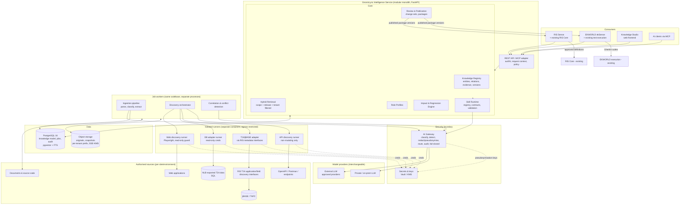
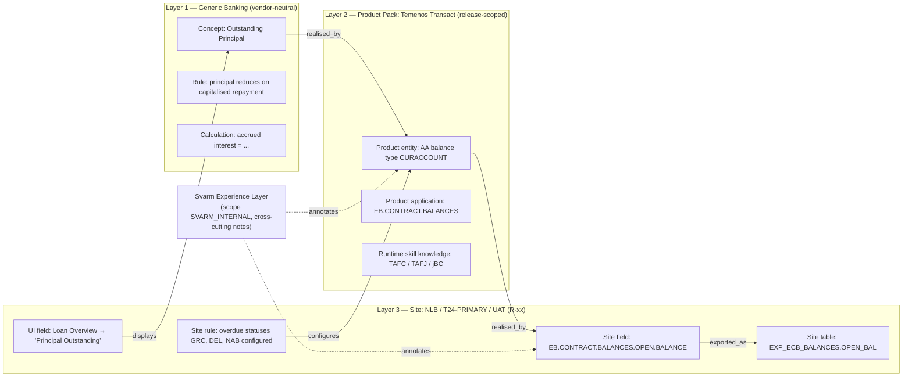

# 01 — Architecture Overview

## 1. Purpose and positioning

GnosisLync is a **banking-aware engineering platform**: it holds a connected, versioned and evidenced model of banking concepts, core banking product implementations and per-site technical reality, and it exposes reusable skills that reason over that model. It is not a document chatbot. Retrieval over documents is one input to the model, not the product.

Consumers:

| Consumer | Uses GnosisLync for | Keeps for itself |
|---|---|---|
| **RIS Sense** | Concept resolution, field/schema lookup, JBC interpretation, mapping and SQL proposals, reconciliation rules | RIS Core execution, scheduling, monitoring, distribution, report configuration store |
| **EKWORLD ekSense** | Banking behaviour, business rules, test scenarios and expected results, UI/API-to-concept enrichment, upgrade impact | Generic UI discovery, Playwright/Robot execution, test management, regression execution |
| **Future** (migration, reconciliation products) | Same API | Own execution engines |

## 2. Architectural principles → design mechanisms

| # | Principle | Mechanism in this design |
|---|---|---|
| P1 | Banking knowledge is the common foundation | `scope = GENERIC` knowledge layer; product and site entities *realise* generic concepts through typed relations (doc 02) |
| P2 | Product knowledge is modular | **Product packs** (`temenos-transact`, later `oracle-flexcube`), each with release catalogue, entity types, adapters and extraction profiles |
| P3 | Site knowledge is first-class | `tenant → site → system_instance → environment` hierarchy; release and runtime belong to the *environment* |
| P4 | Progressive knowledge building | Discovery snapshots, candidate assertions, review, publication as versioned **Site Knowledge Packages** |
| P5 | Roles apply expertise; skills do work | Role = configuration profile (doc 04). Skill = versioned, typed operation. No agent-per-step |
| P6 | AI reasoning separate from deterministic execution | Every skill declares `execution_class`; LLM output is always a *proposal* validated by deterministic checks before persistence |
| P7 | Traceable assertions | Every entity version / relation carries `evidence` rows pointing to source artefacts with locators |
| P8 | RIS/EKWORLD keep their engines | Integration through APIs and outbound "submit" calls only |
| P9 | Client isolation | Tenant-scoped rows + PostgreSQL RLS + per-tenant encryption keys + per-tenant object-storage prefixes; optional dedicated deployment |
| P10 | Extensible without redesign | Product-pack plugin contract, generic entity/relation model with typed `kind` registry |

## 3. Logical architecture



### 3.1 Knowledge layers



A fourth, cross-cutting **Svarm Experience** scope stores specialist practical knowledge (§15.D). It can attach to any layer, and confidentiality flags decide whether it can be reused across clients (doc 08 §6).

## 4. Service boundaries

GnosisLync is a **modular monolith** with a small number of separately deployed processes. Each boundary below has a concrete reason: a security boundary, isolation of untrusted execution, or different scaling.

| Deployable | Responsibility | Why separate |
|---|---|---|
| `gnosis-api` | REST + MCP, request context, authorisation, knowledge registry, retrieval, synchronous skills, review/publication | Core; stateless, horizontally scalable |
| `gnosis-worker` | Ingestion, extraction, discovery orchestration, correlation, regression runs (Postgres-backed job queue) | Long-running jobs; independent scaling |
| `ai-gateway` | The only egress path to any LLM; PII detection, transformation, routing, audit | **Security boundary**. Holds pseudonymisation key access. Can be audited and certified independently. Network policy denies LLM egress from every other pod |
| `discovery-runner-*` (web, db, api, t24) | Execute adapters against source systems | **Untrusted interaction** with client systems. Only these runners hold source credentials (short-lived, from Vault). Egress-restricted per job. Ephemeral containers |
| `studio-web` | Knowledge Studio SPA (static assets) | Frontend |

Internal modules of `gnosis-api` / `gnosis-worker` (Python packages, enforced with `import-linter` contracts):

```
gnosis.context        request context, tenancy, policy decision point client
gnosis.knowledge      entity/relation/evidence/version repositories, lifecycle state machine
gnosis.retrieval      hybrid search, scope resolver, release compatibility
gnosis.skills         registry, runtime, contracts, skill implementations
gnosis.roles          role profiles, prompt assembly
gnosis.review         change sets, approvals, publication, packages
gnosis.ingestion      parsers, classifiers, extractors, consolidation
gnosis.discovery      orchestrator, snapshot store, diffing
gnosis.packs.*        product packs (banking_core, temenos_transact, ...)
gnosis.adapters.*     source adapters (sql, t24_ris, jbase, xmljson, web, api)
gnosis.impact         dependency graph traversal, knowledge regression
gnosis.integration    RIS, EKWORLD clients
gnosis.audit          audit events, compliance evidence
```

## 5. Key decisions (DR records)

### DR-01 — General-purpose LLM, no fine-tuning (initially)
- **Decision:** Use interchangeable general-purpose LLMs behind the AI Gateway. Ground every answer in structured knowledge plus retrieval, and constrain outputs with JSON schemas and deterministic validators.
- **Alternatives:** Fine-tune a banking model. Use a domain-pretrained model.
- **Trade-offs:** Fine-tuning would bake in unverifiable, unversioned and non-isolatable knowledge, which conflicts with P7/P9 because client knowledge must not leak into model weights. Grounding keeps knowledge auditable and revocable. The limitation is higher prompt cost and dependence on retrieval quality. This is mitigated by structured knowledge-first retrieval (entities before chunks). Fine-tuning *small* models on Svarm-owned, generic-scope data for classification may be revisited later.

### DR-02 — PostgreSQL + pgvector + FTS, no graph database (initially)
- **Decision:** One PostgreSQL cluster holds structured knowledge, embeddings (pgvector, HNSW) and full-text (`tsvector`, plus `pg_trgm` for identifiers such as `AC.WORKING.BALANCE`).
- **Alternatives:** Neo4j/Neptune for relations. A dedicated vector DB (Qdrant, Weaviate). OpenSearch.
- **Trade-offs:** Expected traversal depth is small (concept → product → site → export column → UI/API: 3–5 hops). Recursive CTEs over an indexed `knowledge_relation` table handle this at our scale (estimated < 50M relation rows per large tenant). A single store gives transactional consistency between knowledge, evidence and review state, and makes RLS-based isolation uniform. **Limitations:** complex graph analytics such as community detection and long path queries will be slow. **Exit path:** relations are explicit edge rows with stable IDs and typed `kind`, so a CDC (logical replication) feed into a graph DB can be added without remodelling.

### DR-03 — Modular monolith, not microservices or a multi-agent framework
- **Decision:** One codebase with enforced module boundaries. Separate processes only for security and isolation reasons (§4).
- **Alternatives:** One microservice per capability. Agent frameworks (LangGraph, CrewAI, AutoGen) with an agent per role.
- **Trade-offs:** The team is small and the domain model is highly connected, so microservices would add distributed transactions around review/publication. Agent frameworks hide control flow and make determinism and audit harder. **Bounded LLM tool loops** are permitted inside specific skills such as `resolve_source_fields` (max steps, allow-listed tools, full trace), implemented with a thin in-house loop over the provider-neutral gateway API.

### DR-04 — Postgres-backed job queue
- **Decision:** A `job` table with `SELECT … FOR UPDATE SKIP LOCKED` (or `procrastinate`), idempotent steps and checkpointing.
- **Alternatives:** Celery + Redis. Temporal.
- **Trade-offs:** No extra infrastructure, and jobs live in the same transaction as their knowledge writes. Temporal is better for very long, complex workflows and becomes the upgrade path if discovery orchestration grows beyond checkpointed steps.

### DR-05 — Tenant isolation: shared schema + RLS by default; dedicated deployment option
- **Decision:** Every tenant-scoped table has `tenant_id`. RLS policies use `current_setting('gnosis.tenant_ids')`, set per transaction by the API from the *authenticated* principal, never from request parameters. Encryption uses per-tenant data keys (envelope encryption) for evidence excerpts and object storage. Banks that require it get a **dedicated deployment** (own DB, own gateway, private LLM).
- **Alternatives:** Schema-per-tenant. Database-per-tenant always.
- **Trade-offs:** RLS is a single control point, but a bug in session setup is a cross-tenant risk. This is mitigated by tenant-isolation regression tests (doc 09), a DB role without `BYPASSRLS`, and a "no tenant context → zero rows" default. Generic and product knowledge (`tenant_id IS NULL`) is shared by design.

### DR-06 — Candidates never auto-promote
- **Decision:** A lifecycle state machine (doc 02 §4) with a hard rule: AI output can create `CANDIDATE` only. Promotion to `VERIFIED` requires either (a) deterministic verification from source metadata, with the basis recorded, or (b) a human approval by a role with review authority over that domain. Financially significant items require (b) even when (a) holds.
- **Trade-offs:** This slows knowledge growth and needs reviewer capacity. Mitigations are batching, prioritisation by consumer demand, and "provisional use" (consumers may opt in to candidates and must label outputs accordingly).

### DR-07 — Knowledge publication as immutable package versions
- **Decision:** Consumers read from a **published Site Knowledge Package version** (an immutable manifest of entity/relation versions). The working copy is never served to consumers by default.
- **Trade-offs:** There is publication latency, but reproducibility is guaranteed: a RIS report definition or EKWORLD test suite records the package version it was generated from, which enables knowledge regression and impact analysis.

### DR-08 — AI Gateway as mandatory, separately deployed boundary
See doc 08. Alternatives (an SDK-level library in each service) are rejected because a library cannot enforce egress. Network policy plus a single process can.

### DR-09 — Synthesised knowledge, with internal provenance
- **Decision:** Knowledge entities hold a Svarm-synthesised `definition`. Source excerpts are stored only as evidence, subject to the source licence `disclosure_policy`. User-facing responses use synthesised text and cite sources as attribution metadata. Verbatim excerpts are returned only where policy allows.
- **Trade-offs:** Synthesis can introduce error. Mitigations: synthesis is evidence-linked, reviewable, and checked by a deterministic n-gram overlap filter (doc 06 §7) to limit verbatim reproduction.

## 6. What exists, what is reused, what is built

**[ASSUMPTION]** The RIS and EKWORLD capabilities below come from the requirements text. Each must be confirmed with the owning team in Phase 0 (doc 11).

| Capability | Status | Approach |
|---|---|---|
| RIS T24 application & field definition retrieval | **Exists (RIS)** | Reuse through `t24_ris` adapter, which wraps the RIS interface. No re-implementation |
| RIS Core: execution, scheduling, monitoring, distribution | **Exists (RIS)** | Untouched. RIS Sense submits approved definitions through the existing RIS Core API |
| RIS report configuration store | **Exists (RIS)** | Read as an *evidence source* for approved mappings (`approved_mapping` import) |
| NLB exported T24 data (SQL) | **Exists (RIS/NLB)** | Read-only discovery via `scan_sql_database` |
| EKWORLD UI discovery (Playwright) | **Exists (EKWORLD)** | `discover_web_application` *calls* EKWORLD discovery where possible. GnosisLync adds banking enrichment only |
| EKWORLD test execution (Playwright/Robot), test management | **Exists (EKWORLD)** | Used as the regression execution platform (doc 09) |
| Gherkin step-definition library in EKWORLD | **Partially exists? [ASSUMPTION]** | Extend with GnosisLync-specific steps (gateway inspection, API assertions) |
| Banking knowledge model, product packs, site model | **Build** | Doc 02 |
| Ingestion & extraction pipeline | **Build** | Doc 06 |
| Discovery orchestrator, SQL/XML/JSON/API adapters, JBC analyser | **Build** | Doc 03 |
| AI Gateway | **Build** (on Presidio + custom recognisers) | Doc 08 |
| Knowledge Studio | **Build** | Doc 07 |
| Skill registry & runtime, role profiles | **Build** | Doc 04 |
| Identity provider | **Reuse** Svarm IdP (OIDC) **[ASSUMPTION]**, else Keycloak | |
| Secrets | **Reuse** existing Vault/KMS if available, else HashiCorp Vault | |

## 7. Technology choices

| Concern | Choice | Notes / alternative |
|---|---|---|
| Language (backend) | Python 3.12 | Ecosystem for parsing, ML, Presidio. Alt: Kotlin/Java (closer to TAFJ, but weaker AI tooling) |
| API | FastAPI + Pydantic v2, OpenAPI 3.1 generated and contract-tested | |
| DB | PostgreSQL 16, pgvector ≥ 0.7 (HNSW), `pg_trgm`, `unaccent` | |
| Migrations | Alembic | |
| Jobs | Postgres queue (`procrastinate`) | DR-04 |
| Object storage | S3-compatible (MinIO on-prem) with SSE-KMS | |
| Document parsing | `unstructured` / Apache Tika (PDF, DOCX, HTML, CHM-extracted HTML), `docling` for layout-aware PDF tables | |
| Embeddings | Via AI Gateway. Default local model (e.g. `bge-m3`/`e5`) so embeddings never require external egress | |
| LLM | Provider-neutral gateway interface. External approved providers plus private deployment option (vLLM-served open-weight model) | |
| PII detection | Microsoft Presidio + custom recognisers (IBAN, BIC, PAN with Luhn, T24 IDs, national IDs per country) | |
| Browser discovery | Playwright (shared with EKWORLD) in sandboxed runner | |
| JBC parsing | In-house lexer + recursive-descent parser for jBC subset (doc 03 §6) | Alt: tree-sitter grammar (none mature for jBC) |
| Frontend | React 18 + TypeScript + Vite, TanStack Query/Table, Cytoscape.js (relationship viewer), Monaco (code/evidence viewer) | |
| AuthN/Z | OIDC + policy engine (OPA/Rego or Cedar) for ABAC decisions | |
| Observability | OpenTelemetry → existing stack. Payload-free spans (doc 08) | |
