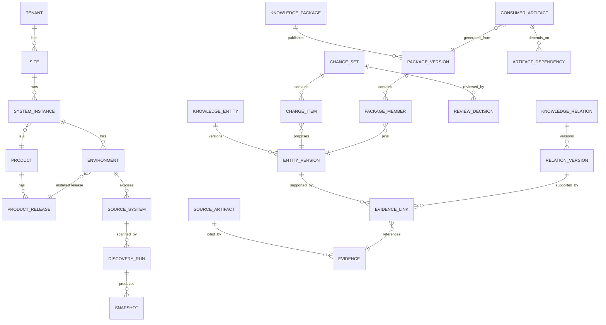
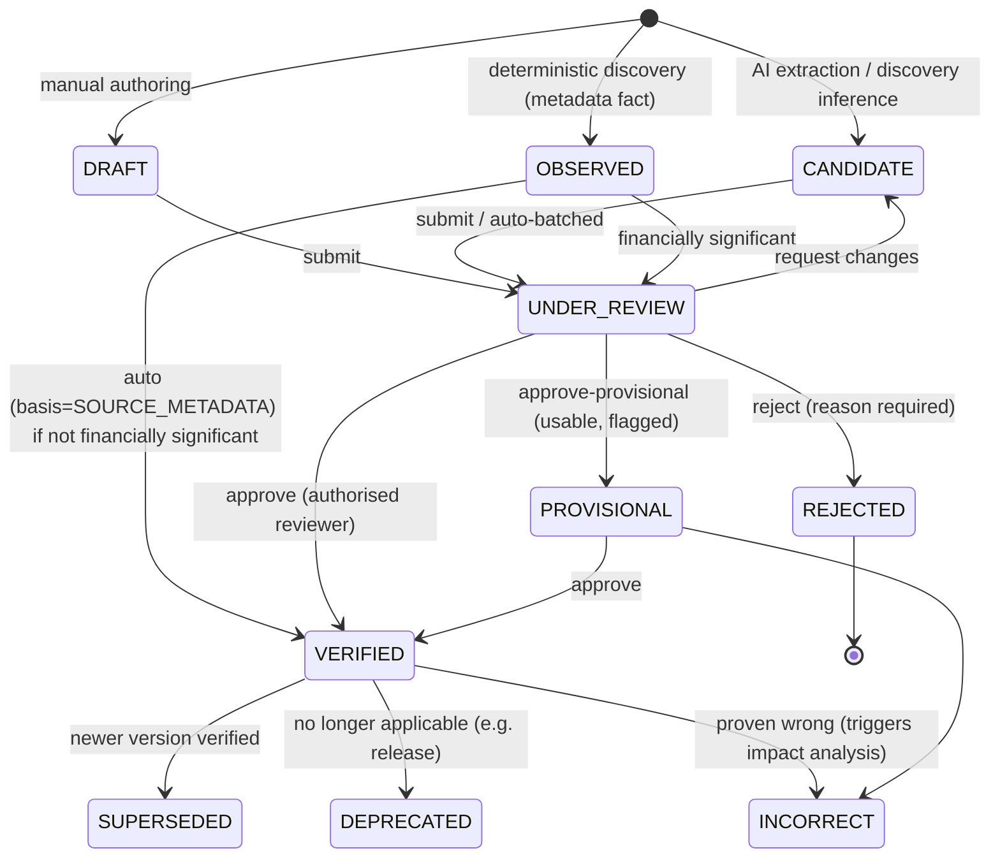

# 02 — Knowledge Data Model

## 1. Modelling approach

- **Typed property graph in relational form.** Every knowledge item is a `knowledge_entity` with a registered `kind`. Every connection is a `knowledge_relation` with a registered `kind`. Kind-specific attributes live in a JSONB `attributes` column validated against a JSON Schema in the **kind registry**. Hot attributes are promoted to typed side tables (e.g. `site_field`, `db_column`) for indexing.
- **Immutable versions.** Entities and relations are identity rows. Content lives in `*_version` rows that are never updated after creation, except for lifecycle-state transitions, which are themselves recorded as events.
- **Scope on every row.** Each entity belongs to exactly one scope: `GENERIC`, `PRODUCT`, `SITE` or `SVARM_INTERNAL`. This drives retrieval, isolation and IP policy.
- **Evidence-first.** Assertions without evidence are invalid, except `SPECIALIST_STATEMENT`, where the evidence *is* the human contribution record.

Why not a fixed table per concept type? Banking and product-pack types will keep growing (FLEXCUBE, payments hubs). A kind registry with JSON Schema validation lets product packs add kinds without migrations. The typed side tables keep query performance where it matters.

## 2. Entity-relationship overview



## 3. Entity kinds (initial registry)

| Layer / scope | Kind | Example | Promoted side table |
|---|---|---|---|
| GENERIC | `banking_domain` | Lending | — |
| GENERIC | `banking_concept` | Outstanding Principal | — |
| GENERIC | `business_event` | Loan Disbursement | — |
| GENERIC | `business_rule` | "Interest accrual stops when the loan is classified non-accrual" | `rule_detail` |
| GENERIC | `calculation` | Actual/365 daily accrual | `calculation_detail` |
| GENERIC | `validation_rule` | GL must balance per currency per business date | `rule_detail` |
| GENERIC | `term` | Synonym/glossary term (e.g. "capital outstanding") | — |
| PRODUCT | `product_module` | Temenos AA (Arrangement Architecture) | — |
| PRODUCT | `product_application` | `AA.ARRANGEMENT`, `ACCOUNT`, `EB.CONTRACT.BALANCES` | `product_application` |
| PRODUCT | `product_field` | `ACCOUNT>WORKING.BALANCE` | `product_field` |
| PRODUCT | `product_concept` | AA balance type, property class, COB job | — |
| PRODUCT | `product_process` | COB stage, EOD batch job | — |
| PRODUCT | `runtime_topic` | TAFJ record storage as XML; jBC `READ` semantics | — |
| PRODUCT | `api_contract` | Transact API published operation | — |
| SITE | `site_application` / `site_field` | Installed definition incl. local fields | `site_field` |
| SITE | `db_schema` / `db_table` / `db_column` / `db_constraint` / `db_routine` | Exported SQL structures | `db_column` |
| SITE | `json_path` / `xml_path` | `$.balances[*].type`, `/row/c12` | `structured_path` |
| SITE | `code_unit` | JBC routine `NLB.LOAN.EXTRACT` | `code_unit` |
| SITE | `code_fact` | "reads ECB, filters TYPE LIKE '...ACCOUNT'" | — |
| SITE | `ui_screen` / `ui_field` / `ui_action` | Infinity screen "Loan Details" | `ui_element` |
| SITE | `api_operation` / `api_field` | `GET /holdings/loans/{id}` | `api_element` |
| SITE | `site_rule` | Bank-specific accounting rule | `rule_detail` |
| SITE | `mapping` | Source-to-target mapping definition | `mapping_detail` |
| SITE | `test_case_ref` | Reference to an EKWORLD test | — |
| SVARM_INTERNAL | `practice_note` | Specialist experience note | — |
| any | `open_question` | Knowledge gap question for specialists | — |

## 4. Lifecycle states

### 4.1 Entity / relation version status



Hard invariants, enforced in the `gnosis.knowledge.lifecycle` module and by a DB trigger:

1. `CANDIDATE → VERIFIED` is not a legal transition. There is no direct edge.
2. A transition into `VERIFIED` requires a `verification_basis` and either `verified_by_rule` (deterministic) or a `review_decision_id`.
3. When `financial_significance IN ('HIGH','MEDIUM')`, `VERIFIED` requires a `review_decision_id` from a principal whose role has `review_authority` over the entity's domain.
4. `VERIFIED` content is immutable. A correction creates a new version, and the old one becomes `SUPERSEDED` only when the new one is verified.

### 4.2 Verification basis (relationship classification required by §4.C)

| `verification_basis` | Meaning | Can be set by |
|---|---|---|
| `SOURCE_METADATA` | Declared in source metadata (FK, STANDARD.SELECTION, OpenAPI `$ref`) | Deterministic adapter |
| `CODE_OBSERVED` | Directly observable in source code (READ of file X keyed by field Y) | JBC analyser (deterministic part) |
| `DOCUMENTATION` | Stated in licensed product or site documentation | Extraction + reviewer confirmation |
| `SPECIALIST_APPROVED` | Approved by domain specialist | Human |
| `DATA_PROFILED` | Supported by authorised profiling (inclusion dependency ≥ threshold) | Profiler, still requires review |
| `AI_INFERRED` | Model inference, not yet validated | LLM skill; status stays CANDIDATE |

`confidence` is stored as auxiliary ranking information and is **never** a promotion criterion.

### 4.3 Epistemic class (§13: facts vs interpretation vs assumptions)

Each version carries `epistemic_class ∈ {FACT, INTERPRETATION, IMPLEMENTATION_SPECIFIC, ASSUMPTION}`. It is rendered in every API response and in Studio.

## 5. DDL (core, abridged but implementable)

```sql
-- ===== Tenancy & site topology ============================================
CREATE TABLE tenant (
  tenant_id        uuid PRIMARY KEY DEFAULT gen_random_uuid(),
  code             text UNIQUE NOT NULL,           -- e.g. 'NLB'
  name             text NOT NULL,
  deployment_mode  text NOT NULL CHECK (deployment_mode IN ('SHARED','DEDICATED')),
  llm_policy_id    uuid NOT NULL,                  -- default AI Gateway policy
  data_region      text NOT NULL,                  -- e.g. 'EU'
  created_at       timestamptz NOT NULL DEFAULT now()
);

CREATE TABLE site (
  site_id    uuid PRIMARY KEY DEFAULT gen_random_uuid(),
  tenant_id  uuid NOT NULL REFERENCES tenant,
  code       text NOT NULL,                        -- 'NLB-SI' (bank entity / country)
  name       text NOT NULL,
  UNIQUE (tenant_id, code)
);

CREATE TABLE product (
  product_id   uuid PRIMARY KEY DEFAULT gen_random_uuid(),
  code         text UNIQUE NOT NULL,               -- 'TEMENOS_TRANSACT', 'ORACLE_FLEXCUBE'
  vendor       text NOT NULL,
  pack_module  text NOT NULL                       -- 'gnosis.packs.temenos_transact'
);

CREATE TABLE product_release (
  release_id    uuid PRIMARY KEY DEFAULT gen_random_uuid(),
  product_id    uuid NOT NULL REFERENCES product,
  code          text NOT NULL,                     -- 'R19', 'R22', '202304'
  ordinal       int  NOT NULL,                     -- total order for range checks
  released_on   date,
  UNIQUE (product_id, code), UNIQUE (product_id, ordinal)
);

CREATE TABLE system_instance (
  instance_id  uuid PRIMARY KEY DEFAULT gen_random_uuid(),
  tenant_id    uuid NOT NULL REFERENCES tenant,
  site_id      uuid NOT NULL REFERENCES site,
  product_id   uuid NOT NULL REFERENCES product,
  code         text NOT NULL,                      -- 'T24-PRIMARY'
  edition      text,                               -- e.g. 'Model Bank', 'Cloud'
  UNIQUE (tenant_id, code)
);

CREATE TABLE environment (
  environment_id   uuid PRIMARY KEY DEFAULT gen_random_uuid(),
  tenant_id        uuid NOT NULL REFERENCES tenant,
  instance_id      uuid NOT NULL REFERENCES system_instance,
  code             text NOT NULL CHECK (code ~ '^[A-Z0-9_-]+$'),  -- 'PROD','UAT','DEV1'
  env_class        text NOT NULL CHECK (env_class IN ('PRODUCTION','UAT','TEST','DEVELOPMENT','DR')),
  release_id       uuid NOT NULL REFERENCES product_release,       -- version belongs HERE
  release_detail   text,                                           -- patch level / service pack
  runtime          text CHECK (runtime IN ('TAFC','TAFJ','OTHER')),
  db_platform      text,                                           -- 'ORACLE','MSSQL','POSTGRES','JBASE'
  enabled_modules  text[] NOT NULL DEFAULT '{}',
  discovery_policy jsonb NOT NULL,          -- allowed methods, profiling allowed?, sample limits
  valid_from       timestamptz NOT NULL DEFAULT now(),
  valid_to         timestamptz,             -- release upgrades create a new row (history)
  UNIQUE (instance_id, code, valid_from)
);

CREATE TABLE source_system (
  source_id       uuid PRIMARY KEY DEFAULT gen_random_uuid(),
  tenant_id       uuid NOT NULL REFERENCES tenant,
  environment_id  uuid NOT NULL REFERENCES environment,
  kind            text NOT NULL CHECK (kind IN
                  ('T24_RIS_METADATA','JBASE','SQL','XMLJSON_STORE','WEB_APP','API','DOC_REPOSITORY','CODE_REPOSITORY')),
  name            text NOT NULL,
  connection_ref  text,          -- Vault path only; never credentials
  config          jsonb NOT NULL,-- adapter config (schemas allow-list, base URL, ...)
  data_class      text NOT NULL CHECK (data_class IN ('METADATA_ONLY','SYNTHETIC','MASKED','PRODUCTION_DATA')),
  approved_by     uuid,          -- principal who authorised the source
  approved_at     timestamptz,
  status          text NOT NULL DEFAULT 'PENDING_APPROVAL'
);

-- ===== Sources, artefacts, evidence =====================================
CREATE TABLE licence_policy (
  licence_id         uuid PRIMARY KEY DEFAULT gen_random_uuid(),
  name               text NOT NULL,                -- 'Temenos customer documentation – NLB licence'
  owner              text NOT NULL,                -- 'Temenos', 'NLB', 'Svarm'
  allowed_tenants    uuid[],                       -- NULL = any tenant authorised by contract
  cross_client_reuse boolean NOT NULL,             -- may derived generic knowledge be reused?
  disclosure_policy  text NOT NULL CHECK (disclosure_policy IN
                     ('VERBATIM_ALLOWED','SHORT_QUOTE_WITH_ATTRIBUTION','SYNTHESIS_ONLY','INTERNAL_ONLY')),
  attribution_text   text,
  external_llm_allowed boolean NOT NULL,
  contract_ref       text
);

CREATE TABLE source_artifact (           -- an uploaded doc, code file, snapshot object, spec
  artifact_id      uuid PRIMARY KEY DEFAULT gen_random_uuid(),
  tenant_id        uuid REFERENCES tenant,         -- NULL = Svarm-wide (generic/product docs)
  scope            text NOT NULL CHECK (scope IN ('GENERIC','PRODUCT','SITE','SVARM_INTERNAL')),
  artifact_type    text NOT NULL,                  -- USER_GUIDE, HELP_TEXT, TECH_MANUAL, JBC_SOURCE, OPENAPI, DB_SNAPSHOT, ...
  title            text NOT NULL,
  product_id       uuid REFERENCES product,
  release_from     int, release_to int,            -- applicable release ordinals (NULL=unknown)
  environment_id   uuid REFERENCES environment,
  object_key       text NOT NULL,                  -- s3://gnosis-<tenant>/artifacts/<sha256>
  sha256           bytea NOT NULL,
  mime_type        text,
  licence_id       uuid NOT NULL REFERENCES licence_policy,
  classification   text NOT NULL CHECK (classification IN ('PUBLIC','INTERNAL','CONFIDENTIAL','RESTRICTED')),
  contains_pii     text NOT NULL DEFAULT 'UNKNOWN' CHECK (contains_pii IN ('NO','YES_REDACTED','YES','UNKNOWN')),
  supersedes_id    uuid REFERENCES source_artifact,
  ingest_status    text NOT NULL DEFAULT 'RECEIVED',
  retention_until  date,
  uploaded_by      uuid NOT NULL,
  uploaded_at      timestamptz NOT NULL DEFAULT now(),
  UNIQUE (tenant_id, sha256)
);

CREATE TABLE evidence (
  evidence_id      uuid PRIMARY KEY DEFAULT gen_random_uuid(),
  tenant_id        uuid REFERENCES tenant,
  artifact_id      uuid NOT NULL REFERENCES source_artifact,
  locator          jsonb NOT NULL,    -- {"page":12,"section":"4.2"} | {"file":"X.b","lines":[40,58]}
                                      -- | {"table":"EXP_ACCOUNT","column":"WORKING_BAL"} | {"url":"...","selector":"..."}
  excerpt_enc      bytea,             -- envelope-encrypted excerpt (tenant DEK); may be NULL (INTERNAL_ONLY)
  excerpt_sha256   bytea NOT NULL,    -- integrity + dedup
  extracted_by     text NOT NULL,     -- 'adapter:sql@1.3.0' | 'skill:extract_domain_knowledge@0.9.2' | 'human'
  created_at       timestamptz NOT NULL DEFAULT now()
);

-- ===== Knowledge entities ===============================================
CREATE TABLE entity_kind (
  kind            text PRIMARY KEY,
  allowed_scopes  text[] NOT NULL,
  attr_schema     jsonb NOT NULL,     -- JSON Schema for attributes
  pack            text NOT NULL       -- 'banking_core' | 'temenos_transact' | 'site_core'
);

CREATE TABLE knowledge_entity (
  entity_id        uuid PRIMARY KEY DEFAULT gen_random_uuid(),
  tenant_id        uuid REFERENCES tenant,          -- NULL for GENERIC/PRODUCT/SVARM_INTERNAL-shared
  scope            text NOT NULL CHECK (scope IN ('GENERIC','PRODUCT','SITE','SVARM_INTERNAL')),
  kind             text NOT NULL REFERENCES entity_kind,
  canonical_key    text NOT NULL,   -- stable natural key, e.g. 'concept:loan.outstanding_principal'
                                    -- 'tt:field:ACCOUNT>WORKING.BALANCE', 'site:sql:EXPDB.T24EXP.EXP_ACCOUNT.WORKING_BAL'
  product_id       uuid REFERENCES product,
  environment_id   uuid REFERENCES environment,
  domain_codes     text[] NOT NULL DEFAULT '{}',    -- taxonomy: 'LENDING','GL','PAYMENTS',...
  merged_into      uuid REFERENCES knowledge_entity,-- duplicate merge (tombstone)
  created_at       timestamptz NOT NULL DEFAULT now(),
  CHECK ((scope = 'SITE') = (tenant_id IS NOT NULL AND environment_id IS NOT NULL)),
  UNIQUE NULLS NOT DISTINCT (tenant_id, environment_id, kind, canonical_key)
);

CREATE TABLE entity_version (
  version_id        uuid PRIMARY KEY DEFAULT gen_random_uuid(),
  entity_id         uuid NOT NULL REFERENCES knowledge_entity,
  tenant_id         uuid REFERENCES tenant,        -- denormalised for RLS
  version_no        int  NOT NULL,
  status            text NOT NULL CHECK (status IN ('DRAFT','CANDIDATE','OBSERVED','UNDER_REVIEW','PROVISIONAL',
                                                   'VERIFIED','REJECTED','SUPERSEDED','DEPRECATED','INCORRECT')),
  name              text NOT NULL,
  definition        text,           -- Svarm-synthesised description (user-facing)
  attributes        jsonb NOT NULL DEFAULT '{}',   -- validated by entity_kind.attr_schema
  release_from      int,            -- product release applicability (ordinal), PRODUCT scope
  release_to        int,
  epistemic_class   text NOT NULL CHECK (epistemic_class IN ('FACT','INTERPRETATION','IMPLEMENTATION_SPECIFIC','ASSUMPTION')),
  verification_basis text CHECK (verification_basis IN ('SOURCE_METADATA','CODE_OBSERVED','DOCUMENTATION',
                                                       'SPECIALIST_APPROVED','DATA_PROFILED','AI_INFERRED')),
  financial_significance text NOT NULL DEFAULT 'NONE' CHECK (financial_significance IN ('NONE','LOW','MEDIUM','HIGH')),
  confidence        real,            -- ranking aid only
  sensitivity       text NOT NULL DEFAULT 'INTERNAL',
  produced_by       text NOT NULL,   -- skill@version | adapter@version | user:<id>
  change_set_id     uuid,
  review_decision_id uuid,
  created_by        uuid,
  created_at        timestamptz NOT NULL DEFAULT now(),
  content_hash      bytea NOT NULL,  -- sha256(name, definition, attributes) for diffing
  embedding         vector(1024),    -- of name+definition (synthesised text only)
  search_tsv        tsvector GENERATED ALWAYS AS
                    (to_tsvector('simple', coalesce(name,'') || ' ' || coalesce(definition,''))) STORED,
  UNIQUE (entity_id, version_no)
);
CREATE INDEX ON entity_version USING hnsw (embedding vector_cosine_ops);
CREATE INDEX ON entity_version USING gin (search_tsv);
CREATE INDEX ON entity_version USING gin (name gin_trgm_ops);
-- current pointer for fast reads
CREATE TABLE entity_head (
  entity_id          uuid PRIMARY KEY REFERENCES knowledge_entity,
  tenant_id          uuid,
  verified_version   uuid REFERENCES entity_version,   -- latest VERIFIED/PROVISIONAL
  working_version    uuid REFERENCES entity_version    -- latest any-status
);

-- ===== Relations ========================================================
CREATE TABLE relation_kind (
  kind          text PRIMARY KEY,   -- see §6
  from_kinds    text[] NOT NULL,
  to_kinds      text[] NOT NULL,
  cross_scope   boolean NOT NULL,   -- e.g. realised_by goes GENERIC→PRODUCT→SITE
  attr_schema   jsonb NOT NULL
);

CREATE TABLE knowledge_relation (
  relation_id    uuid PRIMARY KEY DEFAULT gen_random_uuid(),
  tenant_id      uuid REFERENCES tenant,  -- set if either endpoint is SITE-scoped
  kind           text NOT NULL REFERENCES relation_kind,
  from_entity    uuid NOT NULL REFERENCES knowledge_entity,
  to_entity      uuid NOT NULL REFERENCES knowledge_entity,
  UNIQUE NULLS NOT DISTINCT (tenant_id, kind, from_entity, to_entity)
);

CREATE TABLE relation_version (
  version_id         uuid PRIMARY KEY DEFAULT gen_random_uuid(),
  relation_id        uuid NOT NULL REFERENCES knowledge_relation,
  tenant_id          uuid,
  version_no         int NOT NULL,
  status             text NOT NULL,           -- same domain as entity_version.status
  verification_basis text NOT NULL,
  attributes         jsonb NOT NULL DEFAULT '{}',  -- e.g. {"join":[["ECB.@ID","AA.ARRANGEMENT.LINKED.APPL.ID"]], "cardinality":"1:N"}
  explanation        text,                    -- why this link (synthesised)
  confidence         real,
  produced_by        text NOT NULL,
  change_set_id      uuid, review_decision_id uuid,
  created_at         timestamptz NOT NULL DEFAULT now(),
  UNIQUE (relation_id, version_no)
);

CREATE TABLE evidence_link (
  evidence_link_id  uuid PRIMARY KEY DEFAULT gen_random_uuid(),
  tenant_id         uuid,
  entity_version_id   uuid REFERENCES entity_version,
  relation_version_id uuid REFERENCES relation_version,
  evidence_id       uuid NOT NULL REFERENCES evidence,
  stance            text NOT NULL CHECK (stance IN ('SUPPORTS','CONTRADICTS','CONTEXT')),
  CHECK (num_nonnulls(entity_version_id, relation_version_id) = 1)
);

-- ===== Review & publication =============================================
CREATE TABLE change_set (
  change_set_id  uuid PRIMARY KEY DEFAULT gen_random_uuid(),
  tenant_id      uuid,
  origin         text NOT NULL,     -- 'INGESTION:<job>','DISCOVERY:<run>','MANUAL','REDISCOVERY:<run>','CORRECTION'
  title          text NOT NULL,
  status         text NOT NULL CHECK (status IN ('OPEN','IN_REVIEW','APPROVED','PARTIALLY_APPROVED','REJECTED','PUBLISHED','WITHDRAWN')),
  risk_level     text NOT NULL,     -- derived: max financial_significance + material-change flags
  required_roles text[] NOT NULL,   -- computed from domains touched
  created_by     uuid, created_at timestamptz NOT NULL DEFAULT now()
);

CREATE TABLE change_item (
  change_item_id   uuid PRIMARY KEY DEFAULT gen_random_uuid(),
  change_set_id    uuid NOT NULL REFERENCES change_set,
  tenant_id        uuid,
  op               text NOT NULL CHECK (op IN ('CREATE','UPDATE','DEPRECATE','MARK_INCORRECT','MERGE','LINK','UNLINK')),
  entity_version_id   uuid REFERENCES entity_version,
  relation_version_id uuid REFERENCES relation_version,
  base_version_id  uuid,            -- version this change was computed against (optimistic concurrency)
  diff             jsonb NOT NULL,  -- field-level diff vs base
  materiality      text NOT NULL CHECK (materiality IN ('COSMETIC','DESCRIPTIVE','SEMANTIC','FINANCIAL')),
  conflict_with    uuid[]           -- other versions it contradicts
);

CREATE TABLE review_decision (
  review_decision_id uuid PRIMARY KEY DEFAULT gen_random_uuid(),
  tenant_id          uuid,
  change_set_id      uuid NOT NULL REFERENCES change_set,
  change_item_id     uuid REFERENCES change_item,   -- NULL = whole set
  reviewer_id        uuid NOT NULL,
  reviewer_role      text NOT NULL,
  decision           text NOT NULL CHECK (decision IN ('APPROVE','APPROVE_PROVISIONAL','REJECT','REQUEST_CHANGES')),
  rationale          text NOT NULL,
  corrected_version_id uuid,        -- if reviewer edited before approving
  signed_hash        bytea NOT NULL,-- sha256 over (item content_hash, decision, reviewer, ts) for tamper evidence
  decided_at         timestamptz NOT NULL DEFAULT now()
);

CREATE TABLE knowledge_package (
  package_id     uuid PRIMARY KEY DEFAULT gen_random_uuid(),
  tenant_id      uuid,              -- NULL for generic / product packs
  scope          text NOT NULL,
  environment_id uuid REFERENCES environment,
  product_id     uuid REFERENCES product,
  code           text NOT NULL      -- 'banking-core', 'temenos-transact', 'NLB/T24-PRIMARY/UAT'
);

CREATE TABLE package_version (
  package_version_id uuid PRIMARY KEY DEFAULT gen_random_uuid(),
  package_id     uuid NOT NULL REFERENCES knowledge_package,
  tenant_id      uuid,
  semver         text NOT NULL,     -- MAJOR = breaking semantic change of a FINANCIAL item
  base_versions  jsonb NOT NULL,    -- {"banking-core":"3.2.0","temenos-transact":"1.4.1@R22"}
  status         text NOT NULL CHECK (status IN ('BUILDING','VALIDATING','VALIDATION_FAILED','PUBLISHED','WITHDRAWN')),
  regression_run_id uuid,           -- knowledge regression evidence (doc 09)
  published_by   uuid, published_at timestamptz,
  manifest_sha256 bytea,
  UNIQUE (package_id, semver)
);

CREATE TABLE package_member (
  package_version_id uuid NOT NULL REFERENCES package_version,
  tenant_id          uuid,
  entity_version_id   uuid REFERENCES entity_version,
  relation_version_id uuid REFERENCES relation_version,
  CHECK (num_nonnulls(entity_version_id, relation_version_id) = 1)
);

-- ===== Consumer artefacts (impact analysis) ============================
CREATE TABLE consumer_artifact (
  consumer_artifact_id uuid PRIMARY KEY DEFAULT gen_random_uuid(),
  tenant_id       uuid NOT NULL,
  consumer        text NOT NULL CHECK (consumer IN ('RIS','EKWORLD','OTHER')),
  external_ref    text NOT NULL,      -- RIS report-def id, EKWORLD test-case id
  artifact_type   text NOT NULL,      -- MAPPING, SQL, REPORT_DEF, TEST_CASE, FEATURE_FILE
  package_version_id uuid NOT NULL REFERENCES package_version,
  status          text NOT NULL,      -- ACTIVE | NEEDS_REVIEW | RETIRED
  UNIQUE (tenant_id, consumer, external_ref)
);
CREATE TABLE artifact_dependency (
  consumer_artifact_id uuid REFERENCES consumer_artifact,
  tenant_id       uuid NOT NULL,
  entity_id       uuid REFERENCES knowledge_entity,
  relation_id     uuid REFERENCES knowledge_relation,
  dependency_role text NOT NULL       -- SOURCE_FIELD, JOIN, FILTER, CALC_RULE, EXPECTED_RESULT
);

-- ===== Discovery =========================================================
CREATE TABLE discovery_run (
  run_id         uuid PRIMARY KEY DEFAULT gen_random_uuid(),
  tenant_id      uuid NOT NULL,
  source_id      uuid NOT NULL REFERENCES source_system,
  skill          text NOT NULL,       -- 'scan_sql_database@1.2.0'
  status         text NOT NULL CHECK (status IN ('QUEUED','RUNNING','CHECKPOINTED','SUCCEEDED','PARTIAL','FAILED','CANCELLED')),
  checkpoint     jsonb,               -- resumable cursor (doc 11 §6)
  requested_by   uuid NOT NULL, started_at timestamptz, finished_at timestamptz,
  stats          jsonb, error jsonb
);
CREATE TABLE snapshot (
  snapshot_id    uuid PRIMARY KEY DEFAULT gen_random_uuid(),
  tenant_id      uuid NOT NULL,
  run_id         uuid NOT NULL REFERENCES discovery_run,
  source_id      uuid NOT NULL,
  object_key     text NOT NULL,       -- normalised snapshot JSON (gz) in object storage
  sha256         bytea NOT NULL,
  previous_snapshot_id uuid REFERENCES snapshot,
  diff_summary   jsonb                -- added/removed/changed counts by object type
);

-- ===== Row-level security (pattern, applied to every tenant-scoped table) =
ALTER TABLE entity_version ENABLE ROW LEVEL SECURITY;
CREATE POLICY tenant_read ON entity_version FOR SELECT USING (
  tenant_id IS NULL                                     -- shared generic/product knowledge
  OR tenant_id = ANY (string_to_array(current_setting('gnosis.tenant_ids', true), ',')::uuid[])
);
CREATE POLICY tenant_write ON entity_version FOR INSERT WITH CHECK (
  tenant_id = ANY (string_to_array(current_setting('gnosis.tenant_ids', true), ',')::uuid[])
  OR (tenant_id IS NULL AND current_setting('gnosis.can_write_shared', true) = 'true')
);
```

Notes:
- `SVARM_INTERNAL` entities may still carry `tenant_id` when they derive from a client engagement and are not cleared for cross-client reuse (doc 08 §6).
- `audit_event`, `principal`, `role_assignment`, `compliance_*` tables are defined in doc 08.

## 6. Relation kinds (initial)

| Kind | From → To | Meaning |
|---|---|---|
| `broader_than` / `part_of` | concept → concept | Taxonomy |
| `synonym_of` | term → concept | Terminology |
| `realised_by` | concept → product_concept/application/field; product_* → site_* | Implementation of a concept |
| `instance_of` | site_field → product_field | Site definition of a product field |
| `exported_as` | site_field → db_column / xml_path / json_path | Export lineage |
| `stored_in` | product_application → db_table (TAFJ) | Physical storage |
| `references` | field → application | T24 cross-application reference (e.g. `CUSTOMER` field → `CUSTOMER` app) |
| `joins_to` | db_column → db_column | Join path (attrs: cardinality, conditions) |
| `derived_from` | field/column → field(s) | Calculated value lineage (attrs: expression) |
| `reads` / `writes` / `calls` | code_unit → application/field/code_unit | Code observation |
| `implements_rule` | code_unit / site_rule → business_rule | Code realises rule |
| `governs` | business_rule → concept/field | Rule applies to |
| `displays` / `captures` | ui_field → concept / site_field | UI binding |
| `exposes` | api_field → concept / site_field | API binding |
| `configures` | site_rule / config entity → product_concept | Site parameterisation |
| `contradicts` | version → version | Conflict |
| `duplicate_of` | entity → entity | Merge candidate |
| `maps_to` | mapping → target field | Mapping target |
| `tested_by` | business_rule → test_case_ref | Traceability |
| `answers` | practice_note → open_question | Gap closure |

## 7. Versioning rules

| Object | Versioning | Identity |
|---|---|---|
| Entity / relation content | Monotonic `version_no`, immutable rows | `canonical_key` stable across versions |
| Product applicability | `release_from`/`release_to` ordinals on the version. A release-specific difference creates a **parallel version** with non-overlapping ranges (both may be VERIFIED) | |
| Environment | Release upgrade closes the current `environment` row (`valid_to`) and opens a new row. Site knowledge is re-baselined via rediscovery (doc 10 §5) | |
| Packages | SemVer. MAJOR when any FINANCIAL-materiality item changes semantics, MINOR for additions, PATCH for descriptive edits | |
| Skills, prompts, role profiles | SemVer in registry. Every output stores `produced_by=skill@version` and `prompt_hash` | |

### Release compatibility resolution

```sql
-- product knowledge applicable to the environment's installed release
SELECT ev.* FROM entity_version ev
JOIN entity_head h ON h.verified_version = ev.version_id
WHERE (ev.release_from IS NULL OR ev.release_from <= :release_ordinal)
  AND (ev.release_to   IS NULL OR ev.release_to   >= :release_ordinal);
```

If knowledge has no release range (`release_from IS NULL`), retrieval marks it `release_applicability = "UNSTATED"` and the response carries a warning. This is how the requirement "don't assume one release's documentation applies to another" is enforced.

## 8. Example records (abridged)

```json
{
  "entity": {"kind":"banking_concept","scope":"GENERIC","canonical_key":"concept:lending.outstanding_principal",
             "domain_codes":["LENDING"]},
  "version": {"version_no":3,"status":"VERIFIED","name":"Outstanding Principal",
    "definition":"The portion of disbursed loan capital not yet repaid, excluding interest, fees and penalties. It includes principal that is due-but-unpaid and overdue unless a context explicitly states 'current (not yet due) principal'.",
    "attributes":{"unit":"AMOUNT","currency_bearing":true,"temporal_nature":"POINT_IN_TIME",
                  "variants":["CURRENT_PRINCIPAL","DUE_PRINCIPAL","OVERDUE_PRINCIPAL"]},
    "epistemic_class":"FACT","verification_basis":"SPECIALIST_APPROVED","financial_significance":"HIGH"}
}
```

```json
{
  "relation": {"kind":"realised_by","from":"concept:lending.outstanding_principal",
               "to":"tt:concept:AA.balance_type.ACCOUNT_family"},
  "version": {"status":"CANDIDATE","verification_basis":"DOCUMENTATION",
    "attributes":{"expression":"SUM(balances WHERE balance_type IN ('CURACCOUNT','DUEACCOUNT') OR balance_type matches '<overdue-status>ACCOUNT')",
                  "site_dependency":"Overdue status codes are configured per product line"},
    "explanation":"Transact AA keeps principal in balance types of the ACCOUNT property, split by lifecycle state. [VERIFY-T24]"}
}
```
