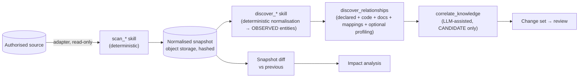
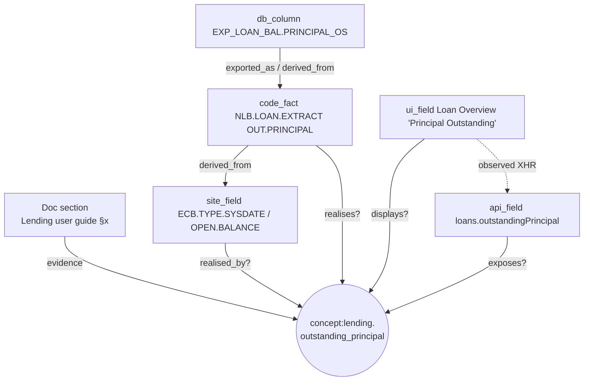

# 03 — Site Knowledge Discovery Engine & Adapters

## 1. Two-stage design: scan → interpret

Discovery is split into two kinds of skill. Raw source access stays deterministic and auditable, and interpretation is replayable.



| Stage | Example skills | LLM? | Output status |
|---|---|---|---|
| Scan | `scan_sql_database`, `scan_jbase_environment`, `discover_fields` (via RIS), `discover_api` (spec parse), `discover_web_application` (crawl) | No | Snapshot |
| Normalise | `discover_schema`, `discover_applications`, `analyze_xml_json_schema` | No (structural inference is statistical, not LLM) | `OBSERVED` |
| Interpret | `discover_relationships` (partly), `analyze_legacy_code` (semantic part), `correlate_knowledge` | Yes | `CANDIDATE` |

## 2. Adapter contract

All adapters implement one Python protocol. They run only inside `discovery-runner-*` containers.

```python
class SourceAdapter(Protocol):
    adapter_id: str            # 'sql.oracle', 't24.ris', 'jbase.tafc', 'web.playwright', 'api.openapi'
    version: str
    capabilities: set[Capability]  # LIST_OBJECTS, DESCRIBE, DDL, SAMPLE, PROFILE, CODE, CRAWL, INVOKE_SAFE

    def preflight(self, ctx: DiscoveryContext) -> PreflightReport:
        """Verify connectivity, credential privileges are read-only, scope allow-list resolvable.
        MUST fail if the credential has write/DDL privileges and policy.require_readonly_credential."""

    def scan(self, ctx: DiscoveryContext, cursor: Cursor | None) -> Iterator[ScanBatch]:
        """Yield normalised objects in batches; each batch is checkpointable (cursor)."""

    def sample(self, ctx: DiscoveryContext, target: ObjectRef, limit: int) -> SampleResult:
        """Only if ctx.policy.sampling_allowed; all values pass the in-runner PII filter
        before leaving the runner (doc 08 §3)."""

@dataclass(frozen=True)
class DiscoveryContext:
    tenant_id: UUID; environment_id: UUID; source_id: UUID; run_id: UUID
    policy: DiscoveryPolicy        # allowlists, sampling, profiling, rate limits, time windows
    credentials: ShortLivedCredential  # fetched from Vault per run, TTL ≤ run timeout
    audit: AuditSink
```

Normalised snapshot format (one JSON-lines file per object type) is shared across adapters so that diffing and `discover_schema` are adapter-independent:

```json
{"type":"column","ref":"T24EXP.EXP_ACCOUNT.WORKING_BAL","data_type":"NUMBER(19,2)","nullable":true,
 "ordinal":14,"comment":null,"source_native":{"oracle_type":"NUMBER","precision":19,"scale":2}}
```

## 3. T24 application & field discovery (reuse RIS) — `discover_applications`, `discover_fields`

**[ASSUMPTION]** RIS exposes an interface (API, library or DB) that returns T24 application definitions and field definitions for a configured environment, derived from `STANDARD.SELECTION` / dictionary metadata, including local reference fields.

Adapter `t24.ris` wraps this interface. It does not query T24 directly:

```python
class RisT24MetadataAdapter(SourceAdapter):
    adapter_id = "t24.ris"
    def scan(self, ctx, cursor):
        for app in self.ris.list_applications(env=ctx.ris_env_ref, after=cursor):
            fields = self.ris.get_field_definitions(env=ctx.ris_env_ref, application=app.name)
            yield ScanBatch(objects=[normalise_app(app)] + [normalise_field(app, f) for f in fields],
                            cursor=app.name)
```

Normalised `t24_field` object (snapshot):

| Attribute | Source | Notes |
|---|---|---|
| `application` | RIS | e.g. `ACCOUNT` |
| `field_name`, `field_no` | RIS | Position matters for jBC `R.REC<n>` resolution |
| `data_type`, `max_len`, `validation` | RIS | Kept as raw T24 type codes plus a normalised type |
| `multi_value`, `sub_value`, `mv_group` | RIS where available | `null` = unknown, **not** false |
| `is_local`, `local_ref_position` | RIS | Local reference sub-fields within `LOCAL.REF` |
| `related_application` | RIS where available (check-file / relation) | Becomes a `references` relation, `SOURCE_METADATA` |
| `field_type` | RIS | Data / I-descriptor / J-descriptor if exposed |

Rules:
- Field semantics (definition text) are **never** generated from the field name alone. `discover_fields` creates site fields with `definition = NULL`. Semantics arrive later via `realised_by`/`instance_of` links to product knowledge (`DOCUMENTATION` basis) or specialist input. The UI shows "meaning not yet established".
- `instance_of` from site field to product field is created deterministically when `application + field_name` match a product-pack field **whose release range includes the environment's release**. Otherwise a CANDIDATE link is created with reason `RELEASE_UNSTATED`.
- Differences between environments (UAT vs PROD) are produced by `compare_schema_versions` over the two snapshots.

## 4. jBASE / TAFC discovery — `scan_jbase_environment`

jBASE files are hashed multi-value files, not relational tables. A record is a dynamic array: attributes (`@FM`), multi-values (`@VM`) and sub-values (`@SM`). Dictionaries (`DICT`) describe positions. Most of T24's structure is defined by T24 itself (`STANDARD.SELECTION`), not by the jBASE dictionary.

Adapter design (`jbase.tafc`), in priority order:

1. **Via RIS/T24 interfaces first** (§3). Applications and fields are always taken from there.
2. **Via a read-only jBASE access channel** — only if approved for the environment. Possible mechanisms **[ASSUMPTION, choose in Phase 0 with RIS/infra]**:
   - an existing RIS extraction routine or service that lists files (`VOC` entries), `DICT` items and code catalogues;
   - jRemote / jAgent-style connector under a read-only account;
   - offline exports (VOC listing, `DICT` dumps, `BP` directories) delivered as artefacts. This is the safest default for v1.
3. **Code catalogues:** the source of `*.BP` directories (e.g. local BP), program catalogue listings (`jshow`, catalogue outputs) from offline export.

Discovered objects: `jbase_file` (name, type such as hashed/directory/distributed if available, `VOC` pointer, company-specific mnemonic prefix such as `F<MNE>.`, suffixes `$NAU`/`$HIS`), `jbase_dict_item` (attribute number, conversion, correlative, justification, MV/SV flags), `code_unit`, `catalog_entry`.

Normalisation rule: `FBNK.ACCOUNT`, `FBNK.ACCOUNT$NAU` and `FBNK.ACCOUNT$HIS` are linked to the single T24 application `ACCOUNT` with `storage_variant ∈ {LIVE, UNAUTH, HISTORY}`. The company mnemonic is captured as `company_mnemonic` [VERIFY-T24 for multi-company setups].

Restrictions: no `EXECUTE` of arbitrary commands, no `SELECT` over data files unless `sampling_allowed`, and no catalogue or compile operations. The runner refuses any command not in a fixed allow-list.

## 5. SQL and semi-structured discovery — `scan_sql_database`, `discover_schema`, `analyze_xml_json_schema`

### 5.1 Relational adapters

One adapter base with dialect plugins (`sql.postgres`, `sql.oracle`, `sql.mssql`, `sql.db2`). They use SQLAlchemy reflection where reliable and dialect catalogue queries where not:

| Object | PostgreSQL | Oracle | SQL Server | DB2 |
|---|---|---|---|---|
| Tables/views | `information_schema.tables` | `ALL_TABLES`, `ALL_VIEWS` | `sys.tables`, `sys.views` | `SYSCAT.TABLES` |
| Columns | `information_schema.columns` | `ALL_TAB_COLUMNS` | `sys.columns` | `SYSCAT.COLUMNS` |
| PK/FK/constraints | `pg_constraint` | `ALL_CONSTRAINTS`, `ALL_CONS_COLUMNS` | `sys.key_constraints`, `sys.foreign_keys` | `SYSCAT.KEYCOLUSE`, `SYSCAT.REFERENCES` |
| Indexes | `pg_index` | `ALL_INDEXES`, `ALL_IND_COLUMNS` | `sys.indexes` | `SYSCAT.INDEXES` |
| Routines | `pg_proc` (+`pg_get_functiondef`) | `ALL_PROCEDURES`, `ALL_SOURCE` | `sys.sql_modules` | `SYSCAT.ROUTINES` |
| View definitions | `pg_views.definition` | `ALL_VIEWS.TEXT` | `sys.sql_modules` | `SYSCAT.VIEWS` |
| XML/JSON types | `xml`, `json`, `jsonb` | `XMLTYPE`, JSON (21c+) / `IS JSON` check | `xml`, `nvarchar` + `ISJSON` check | `XML` |

Preflight checks the privileges of the supplied account and fails if it can `INSERT/UPDATE/DELETE/DDL` on in-scope schemas, unless the source owner records an override with justification. Sessions are also opened read-only (`SET TRANSACTION READ ONLY`, `default_transaction_read_only`, Oracle read-only user, SQL Server `ApplicationIntent=ReadOnly`). Statement timeouts are set and fetch sizes capped.

Procedures, functions and view definitions are stored as `code_unit` artefacts, then passed through the PII scanner, because literals may contain data.

### 5.2 Semi-structured structure inference

`analyze_xml_json_schema` input: an XSD/JSON Schema if available, otherwise **authorised samples** (sampling must be allowed by policy). Samples pass through the in-runner PII filter first. Only structure and value *shapes* are retained, never values, unless the value is a code-list value (enum candidate) with cardinality ≤ 50 that passes the PII scan.

Algorithm (deterministic):
1. Parse each document into a path tree (`/row/c12[@m]`, `$.balances[*].type`).
2. Per path: occurrence ratio, type set (string/number/date-like/boolean/object/array), array cardinality distribution, enum candidates.
3. Emit `structured_path` entities with `presence = REQUIRED | OPTIONAL | RARE` and `type_confidence`. Paths with heterogeneous types are flagged `VARIABLE_STRUCTURE` and carry explicit uncertainty.
4. Detect embedded identifiers (paths whose value domain matches another path or column's domain) → relationship candidates for §7.

**TAFJ special case [VERIFY-T24]:** In TAFJ on an RDBMS, T24 records are typically stored as `RECID` plus an XML (or, depending on DB and release, JSON-like) record column, where elements correspond to field positions with attributes for multi-value/sub-value positions. The `temenos_transact` pack provides a **record-format decoder** keyed by `(runtime, db_platform, release)`. It maps positional elements (`c<n>`) to field names using the site field definitions from §3, so XML paths link deterministically to `site_field` (`exported_as`, `SOURCE_METADATA`). This deterministic join is the most valuable discovery step for TAFJ sites.

## 6. Legacy code discovery — `analyze_legacy_code` (JBC first)

### 6.1 Deterministic static analysis

Lexer + recursive-descent parser for jBC/T24 BASIC (subset sufficient for T24 local development):

| Construct | Extracted fact (`code_fact`, basis `CODE_OBSERVED`) |
|---|---|
| `$INSERT I_F.ACCOUNT` / `$INCLUDE` | Imports field equates for `ACCOUNT` → resolve `AC.WORKING.BALANCE` → field position/name via site field definitions |
| `OPEN`/`OPF`, `F.READ`, `CACHE.READ`, `READ`, `READU`, `F.WRITE`, `WRITE` | File access (read/write), file variable binding, key expression |
| `R.ACCOUNT<AC.WORKING.BALANCE>`, `R.REC<12,3>` | Field reference (resolved name or unresolved position) |
| `SELECT`/`EXECUTE "SELECT ... WITH ..."`, `DAS` calls, `EB.READLIST` | Selection logic. Selection string parsed into filter AST |
| `CALL X`, `CALLJ` (TAFJ Java), `GOSUB` | Call graph (external vs internal) |
| `IF/CASE` with `TODAY`, `R.DATES(EB.DAT.*)` | Date conditions (business-date awareness) |
| Arithmetic assignments into output buffers | Derivation expressions |
| `WRITESEQ`, `PRINT`, delimiter building | Output layout (column order, delimiters) |

Output of the deterministic pass: an **intermediate representation** (IR) per routine:

```json
{
  "routine":"NLB.LOAN.EXTRACT", "source":{"artifact_id":"…","sha256":"…"},
  "inserts":["I_COMMON","I_EQUATE","I_F.AA.ARRANGEMENT","I_F.EB.CONTRACT.BALANCES"],
  "file_access":[{"var":"F.ECB","file":"EB.CONTRACT.BALANCES","mode":"READ","key_expr":"ARR.ID","lines":[44,46]}],
  "selections":[{"file":"AA.ARRANGEMENT","filter":{"and":[{"field":"PRODUCT.LINE","op":"EQ","value":"LENDING"},
                {"field":"ARR.STATUS","op":"IN","value":["CURRENT","EXPIRED"]}]},"lines":[30,31]}],
  "field_refs":[{"app":"EB.CONTRACT.BALANCES","field":"TYPE.SYSDATE","resolved":true,"lines":[52]},
                {"app":"EB.CONTRACT.BALANCES","position":"<5,VM>","resolved":false,"lines":[58]}],
  "calls":[{"target":"AA.GET.PERIOD.BALANCES","kind":"EXTERNAL","resolved":"PRODUCT_API","lines":[61]}],
  "derivations":[{"target":"OUT.PRINCIPAL","expr":"SUM over VM where TYPE matches '*ACCOUNT' of OPEN.BAL+CREDIT.MVMT+DEBIT.MVMT","lines":[55,66]}],
  "outputs":[{"channel":"WRITESEQ","file":"NLB.LOAN.OUT","columns":["ARR.ID","CCY","OUT.PRINCIPAL"],"lines":[80,84]}],
  "unresolved":[{"kind":"FIELD_POSITION","detail":"R.ECB<5,VM>","reason":"no insert equate; position 5 not in site definitions for release"}]
}
```

(Field names above are illustrative. Real names are resolved from the site definitions. [VERIFY-T24])

### 6.2 LLM interpretation (bounded)

The IR, **not raw code**, is passed with the relevant product knowledge to the LLM, through the gateway with literal/PII scanning (doc 08). The LLM produces:
- the business purpose (INTERPRETATION),
- candidate business rules (`extract_business_rules`),
- concept links for derived outputs (`OUT.PRINCIPAL` → `concept:lending.outstanding_principal`, CANDIDATE).

Validator: every claim must cite IR line ranges, and every field it mentions must exist in the IR. Otherwise the claim is dropped and logged (`HALLUCINATED_REFERENCE`).

Extension plan: Java/TAFJ customisations (JavaParser-based, same IR), FLEXCUBE PL/SQL (ANTLR PL/SQL grammar, same IR).

## 7. Relationship discovery — `discover_relationships`

Evidence channels are combined. Each produces relation candidates with a basis:

| # | Channel | Basis | Auto-verified? |
|---|---|---|---|
| 1 | Declared DB FKs, T24 check-file relations, OpenAPI `$ref`/links | `SOURCE_METADATA` | Yes (`OBSERVED → VERIFIED`), unless financially significant |
| 2 | Product documentation | `DOCUMENTATION` | No |
| 3 | Known T24 application references (product pack) | `DOCUMENTATION` | No (unless pack item verified and release matches → `PROVISIONAL`) |
| 4 | Approved RIS mappings (import) | `SPECIALIST_APPROVED` (provenance retained: original approver) | Yes, if approver identity and approval record are imported |
| 5 | JBC IR: read-by-key (`F.READ ECB, ARR.ID`) | `CODE_OBSERVED` | Yes for "routine joins A to B on key"; **not** for business meaning |
| 6 | Data profiling (opt-in, inclusion dependency, cardinality) | `DATA_PROFILED` | Never |
| 7 | Name/type similarity, LLM reasoning | `AI_INFERRED` | Never |

Scoring merges channels per `(from, to)` pair, and evidence from every channel is attached. Status is the **maximum allowed** by the strongest *non-AI* basis. AI channels can only add explanation and ranking.

Profiling (channel 6) runs aggregate SQL only (`COUNT(DISTINCT)`, anti-join counts) inside the runner. No row values leave the runner.

## 8. Web application discovery — `discover_web_application`

**Reuse:** EKWORLD's existing Playwright discovery produces the page/element inventory **[ASSUMPTION: EKWORLD exposes discovery output via API]**. GnosisLync calls it, or runs its own runner using the same library if EKWORLD's output is insufficient.

Safety guard (enforced in runner, not prompt):
- Authorised test account only, approved environment (`env_class ≠ PRODUCTION` unless explicitly approved for read-only exploration).
- **Action guard:** no clicks on elements whose accessible name or role matches commit-type actions (`submit`, `save`, `authorise`, `approve`, `commit`, `delete`, `transfer`, `pay`, site-configurable list, multilingual). Form *inspection* only. No input in fields except search/navigation fields on an allow-list.
- Network guard: Playwright route interception blocks non-GET/HEAD requests unless allow-listed (e.g. a login POST, enquiry POSTs proven idempotent and allow-listed by a specialist).
- Screenshots are stored only after OCR-based PII masking. Default is DOM structure without screenshots.
- Crawl budget (pages, depth, time) and rate limits.

Output: `ui_screen`, `ui_field` (label, control type, required, validation messages, options), `ui_action` (visible, *not executed*), navigation graph. The LLM then proposes `displays`/`captures` links from UI fields to concepts and site fields, using labels, screen context, Temenos/Infinity product knowledge and the API traffic observed during navigation. A field label "Principal Outstanding" alone yields `AI_INFERRED`. An observed XHR whose response field feeds that element yields a `CODE_OBSERVED`-grade binding link.

## 9. API discovery — `discover_api`

Inputs: OpenAPI 2/3.x, Postman v2.1, API documentation URL (fetched by runner, parsed into an OpenAPI draft), approved endpoints.

Deterministic: parse operations, schemas, security schemes, constraints (`pattern`, `enum`, `min/max`), `$ref` graph → `api_operation`, `api_field`, `references` relations (`SOURCE_METADATA`).

Optional validation calls: only `GET`/`HEAD`/`OPTIONS`, and only operations marked safe in the spec *and* on the approved list. Responses are scanned for PII in the runner and only structure is retained. `POST/PUT/PATCH/DELETE` are never invoked. The rule is enforced in the HTTP client wrapper, which raises `MutationBlocked`.

LLM-assisted: concept mapping of API fields (CANDIDATE), and grouping operations into business operations ("Create loan arrangement").

## 10. Cross-source correlation — `correlate_knowledge`

Goal: connect the representations of one concept across docs, T24 fields, code, SQL, UI and APIs.



Algorithm:
1. **Blocking** (deterministic): candidate pairs come from (a) lineage edges already known, (b) name/label token similarity using terminology synonyms (`term` entities, multilingual), (c) embedding similarity of synthesised descriptions, (d) type compatibility (amount ↔ amount, currency-bearing). Pairs are capped per entity.
2. **Structural propagation** (deterministic): if `column exported_as field` is VERIFIED and `field realised_by concept` is VERIFIED, then propose `column realises concept` with basis inherited as `DERIVED_FROM_VERIFIED_CHAIN` (stored as `SOURCE_METADATA` plus a chain reference). It still requires review if financially significant.
3. **LLM adjudication**: for remaining pairs, the role-scoped prompt includes both entities, their evidence summaries and product knowledge. Output schema: `{link: bool, relation_kind, explanation, cited_evidence_ids[], counter_evidence[]}`. Citations are validated deterministically.
4. **Conflict check** with `detect_knowledge_conflicts` before candidates are queued.
5. A change set is created, grouped by concept, with prioritisation by consumer demand (RIS/EKWORLD open requests for that concept first).

Every link remains CANDIDATE until reviewed (DR-06).

## 11. Snapshot diffing and change detection — `compare_schema_versions`

Deterministic structural diff of two snapshots (same source, or two environments):

| Change type | Detection | Default materiality |
|---|---|---|
| Object added/removed | key set difference | SEMANTIC |
| Column/field type change | type normalisation compare | SEMANTIC; FINANCIAL if amount/rate/date |
| MV/SV flag change | attribute compare | FINANCIAL if any mapping depends on it |
| Rename (heuristic) | removed+added with same type/position/comment → candidate rename | Requires review |
| Constraint/FK change | — | SEMANTIC |
| Routine source change | sha256 diff, then IR diff | per IR delta (derivation change ⇒ FINANCIAL) |

The diff feeds `gnosis.impact`: reverse traversal from changed entities through `artifact_dependency` to RIS mappings and EKWORLD tests (doc 09 §6).
