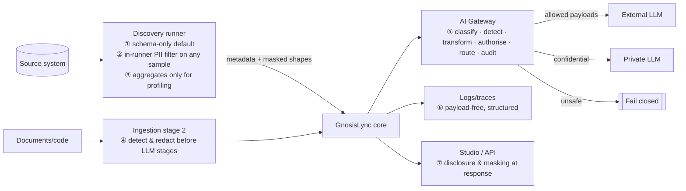

# 08 — Security, Privacy, Regulatory Compliance

> These controls are designed to **support** GDPR and DORA obligations of the banks (financial entities and controllers) and of Svarm (processor and ICT third-party service provider). They do not by themselves establish compliance. Organisational assessment, contracts and independent review remain necessary.

## 1. Data classification

| Class | Examples | Default handling |
|---|---|---|
| `PUBLIC` | Public regulations, Svarm public material | Any approved LLM |
| `INTERNAL` | Generic banking knowledge, Svarm practice notes | Approved external LLMs under DPA |
| `CONFIDENTIAL` | Client schemas, site config, client code, licensed vendor docs | External LLM only if tenant policy + licence allow; else private model |
| `RESTRICTED` | Customer personal data, account/card numbers, credentials, keys | **Never** to external LLM. Never stored in knowledge. Masked at source runner |

Sensitive-data types detected: names, addresses, emails, phones, national IDs (per-country recognisers, e.g. Slovenian EMŠO/tax number), dates of birth, IBAN (mod-97 check), BIC, PAN (Luhn), account numbers (site-configured patterns), T24 customer/account/arrangement IDs (site-configured patterns), passwords/tokens/keys (entropy + pattern, gitleaks rules), IP addresses, free-text narrative fields (treated as potentially personal).

## 2. Privacy by design: where data is stopped



Defaults: `data_class = METADATA_ONLY` for every new source. Sampling and profiling need explicit approval (source owner + Privacy Officer). Test data comes from **synthetic generators** driven by the knowledge model (types, code lists, constraints), not from copies of production.

## 3. AI Gateway

### 3.1 Responsibilities and placement

- A separate deployment (`ai-gateway`). It is the only workload allowed to reach model endpoints. Kubernetes `NetworkPolicy` and the egress proxy allow-list enforce this.
- Provider-neutral API: `POST /gw/v1/completions`, `POST /gw/v1/embeddings`.
- Callers authenticate with workload identity (SPIFFE/mTLS). The request carries a signed **context envelope** (tenant, environment, purpose, skill@version, role, data-classes claimed, request id) issued by `gnosis-api`.

### 3.2 Processing pipeline

```mermaid
flowchart TB
  IN[Request + context envelope] --> A[1 Authorise<br/>tenant ↔ sources referenced, purpose, skill allowed to use LLM]
  A --> B[2 Classify<br/>max classification of all included evidence/artefacts by id + content scan]
  B --> C[3 Detect<br/>Presidio + custom recognisers + secrets rules]
  C --> D[4 Transform per policy<br/>REDACT · PSEUDONYMISE(det.) · GENERALISE · DROP-FIELD]
  D --> E[5 Re-scan transformed payload<br/>residual risk score]
  E -->|residual > threshold| X[[BLOCK or route PRIVATE]]
  E --> F[6 Route<br/>policy: tenant × classification × purpose → provider/model/region]
  F --> G[7 Prompt security<br/>injection heuristics on untrusted segments, delimiting, size limits]
  G --> H[Provider call<br/>timeouts, retries, circuit breaker]
  H --> I[8 Response checks<br/>schema, re-scan for PII/secrets, no token leakage, output-handling guard]
  I --> J[9 Audit<br/>hashes & decisions only]
  J --> OUT[Response to caller, pseudonyms intact]
```

### 3.3 Policy (example)

```yaml
# policies/llm/nlb.yaml
tenant: NLB
version: 3
external_llm_allowed: true                  # set false for banks requiring no external processing
allowed_providers:
  - {id: provider-a-eu, region: EU, dpa_ref: "DPA-2026-014", zero_retention: true, max_class: CONFIDENTIAL}
  - {id: private-vllm, region: NLB-DC, max_class: CONFIDENTIAL}
routing:
  - {when: {classification: RESTRICTED}, action: BLOCK}          # restricted never sent anywhere
  - {when: {classification: CONFIDENTIAL, source_kind: CODE}, route: private-vllm}
  - {when: {classification: CONFIDENTIAL}, route: provider-a-eu, require: [licence_external_ok]}
  - {when: {classification: [INTERNAL, PUBLIC]}, route: provider-a-eu}
transforms:
  PERSON: PSEUDONYMISE
  IBAN: PSEUDONYMISE
  ACCOUNT_ID: PSEUDONYMISE
  NATIONAL_ID: REDACT
  PAN: REDACT
  SECRET: REDACT_AND_ALERT
  EMAIL: REDACT
residual_risk_threshold: 0.0                # any residual RESTRICTED entity ⇒ block
on_provider_failure: {fallback: private-vllm, else: FAIL}         # never fall back to a less-trusted provider
```

### 3.4 Deterministic pseudonymisation

- Token = `<TYPE_` + base32(HMAC-SHA256(K_tenant,purpose, normalised_value))[:10] + `>`, for example `<ACCOUNT_K3F9QX2M1A>`.
- `K_tenant,purpose` is derived via HKDF from a tenant key held in Vault Transit. Only the gateway can request derivation. Keys are separated per purpose, so tokens cannot be linked across purposes.
- Because tokens are consistent, relationships across records survive (the same account appears as the same token).
- **Re-identification map:** not stored by default, since HMAC is one-way. Where reversibility is needed (e.g. test-data provisioning), a separate **Re-identification Vault** service stores encrypted token→value pairs. It is accessible only via a dual-approved break-glass workflow with time-bound access, and every lookup is audited. AI services have no network route to it.
- Pseudonymised data is still personal data under GDPR (Recital 26). Policies, DPIAs and transfer assessments treat it that way.

### 3.5 Audit record (no sensitive payloads)

```json
{"event":"LLM_REQUEST","ts":"2026-11-20T10:31:02Z","request_id":"…","tenant":"NLB","environment":"NLB/T24-PRIMARY/UAT",
 "skill":"analyze_legacy_code@0.6.1","purpose":"REPORTING","principal":"svc:ris-sense","role":"t24_technical_developer",
 "classification":"CONFIDENTIAL","detections":{"PERSON":0,"IBAN":2,"SECRET":1},"transforms":{"IBAN":"PSEUDONYMISE","SECRET":"REDACT"},
 "decision":"ROUTED","provider":"private-vllm","model":"…","prompt_sha256":"…","response_sha256":"…",
 "input_tokens":5120,"output_tokens":830,"latency_ms":4210,"policy_version":3}
```

Payloads are not logged. A short-lived encrypted **forensic capture** (≤ 7 days, tenant key, access via break-glass) may be enabled per tenant for incident investigation only.

### 3.6 Failure behaviour

| Situation | Behaviour |
|---|---|
| Detector error / timeout | **Block** (fail closed). Skill returns `BLOCKED_BY_POLICY` / `PRIVACY_CHECK_UNAVAILABLE` |
| Provider timeout / 5xx | Retry with jittered backoff (max 2), circuit breaker per provider, fallback only to an equal-or-more-trusted provider per policy, else `LLM_UNAVAILABLE` |
| Response contains residual PII or secret | Drop response, alert, `RESPONSE_POLICY_VIOLATION` |
| Response not schema-valid | One repair attempt (same provider), then fail |

Deterministic platform functions (retrieval, verified knowledge lookup, diffing) keep working when LLMs are unavailable. Consumers receive degraded but correct responses (`status: OK`, with `llm_features_unavailable: true`).

## 4. Access control

- **Authentication:** OIDC (Svarm IdP), MFA for Studio. Service accounts use client credentials + mTLS.
- **Authorisation:** RBAC (roles, doc 04) + ABAC attributes (tenant, environment class, data class, domain, purpose). Decisions come from a policy engine (OPA or Cedar) and are evaluated in `gnosis-api` *and* re-checked in the DB (RLS).
- **Tenant isolation:** RLS (doc 02 §5), per-tenant DEKs, per-tenant object-storage prefixes with bucket policies, per-tenant Vault paths, and cache keys namespaced by tenant. Embedding search applies the tenant filter **before** kNN (filtered HNSW / partial indexes by tenant for large tenants) to avoid cross-tenant neighbour leakage.
- **Discovery credentials:** Vault dynamic or static read-only credentials, leased per run (TTL = run timeout). Only runners can read them, and they never appear in GnosisLync core memory or logs.
- **No production code execution:** runners have no capability to compile, catalogue or execute T24 code, and command allow-lists are enforced (doc 03). Web discovery uses the action and network guards. API discovery blocks mutation.

## 5. Encryption, retention and deletion

- TLS 1.3 in transit (mTLS in-cluster). Encryption at rest: PostgreSQL volume encryption + column-level envelope encryption for evidence excerpts. Object storage SSE-KMS per tenant key.
- Retention: per `source_artifact.retention_until` and tenant policy. Audit retention follows the bank's contractual requirement (default 7 years for approval and audit evidence, configurable).
- **Secure deletion / crypto-shredding:** deleting a tenant destroys its DEKs. Deleting an artefact removes the object and the evidence excerpts. Derived knowledge versions are flagged `EVIDENCE_WITHDRAWN` and go to review, because they may need a replacement evidence basis or deprecation.
- **Data-subject requests:** the knowledge model stores no customer personal data by design (metadata only). The DSR workflow searches artefacts, evidence excerpts and forensic captures by pseudonym token (HMAC of the supplied identifier) and plaintext detectors, then reports and erases. Every DSR has an audit trail.

## 6. IP, licensing and cross-client knowledge

| Knowledge origin | Default scope | Reuse across clients |
|---|---|---|
| Svarm-authored generic knowledge | GENERIC / SVARM_INTERNAL | Yes |
| Derived from vendor docs licensed to Svarm | PRODUCT | Per `licence_policy.cross_client_reuse` |
| Derived from vendor docs licensed to a client | PRODUCT, `tenant_id` set | No, unless legal clears it |
| Client code, schemas, config, specifications | SITE | Never |
| Specialist notes from an engagement | SITE or SVARM_INTERNAL with `tenant_id` | Only after **generalisation review**: Knowledge Steward + engagement lead confirm no client-confidential content. Content is rewritten generically, and the original link stays internal |

Controls: licence selection is mandatory on upload, and the disclosure policy is applied at response time (doc 06 §7). A **contamination check** runs at generalisation review: an LLM-free scan for site identifiers (tenant code, site-specific application prefixes such as `NLB.`, local field names, URLs) in the text proposed for generalisation.

## 7. Threat model (STRIDE + OWASP LLM Top 10 2025)

| # | Threat | Surface | Control(s) | Test (doc 09) |
|---|---|---|---|---|
| T1 | Cross-tenant data access via API parameter tampering | API | Context from token, RLS, policy engine | `@tenant-isolation` suite |
| T2 | Cross-tenant leakage via vector search or cache | Retrieval | Pre-filtered search, namespaced caches | Isolation tests incl. kNN |
| T3 | Prompt injection embedded in uploaded docs, code comments, web pages, API descriptions (LLM01) | Ingestion, discovery | Untrusted content delimited and never treated as instructions. Tools in bounded loops are read-only. Output schema validation. Injection heuristics in gateway | Injection corpus tests |
| T4 | Sensitive data disclosure to provider (LLM02) | Gateway | Detect/transform/block, private routing, zero-retention DPAs | Gherkin privacy scenarios |
| T5 | Supply chain: compromised packages, model artefacts (LLM03) | Build | SBOM (CycloneDX), pinned hashes, osv-scanner, signed images (cosign), private model checksums | CI gates |
| T6 | Knowledge poisoning: malicious or erroneous document creates false rules (LLM04) | Ingestion | Candidates never auto-promote. Evidence + reviewer. Conflict detection | `inferred-marked-verified` scenarios |
| T7 | Improper output handling: generated SQL executed with side effects (LLM05) | generate_sql | Parse, SELECT-only allow-list (`sqlglot` AST), execution only by RIS under its own controls | SQL guard unit tests |
| T8 | Excessive agency (LLM06) | Skills | No write tools for LLM. Bounded steps. Human publication | Registry policy tests |
| T9 | System prompt / policy leakage (LLM07) | API | No secrets in prompts. Prompts treated as non-secret but versioned | — |
| T10 | Misinformation: wrong financial calculation presented as fact (LLM09) | All | Status labels, VERIFIED-only default, deterministic validators, recon checks, four-eyes for HIGH | Calculation regression scenarios |
| T11 | Unbounded consumption / cost DoS (LLM10) | Gateway | Per-tenant quotas, token budgets, rate limits | Load tests |
| T12 | Discovery causes state change in bank system | Runners | Read-only creds + preflight, web action/network guard, API mutation block, command allow-list | Runner guard tests |
| T13 | Credential theft from runners | Runners | Vault short-lived leases, ephemeral containers, no shell, egress allow-list per job | Pen test |
| T14 | Tampering with approved knowledge | DB/API | Immutable versions, signed review decisions, audit hash chain, DB role separation | `unauthorised-modification` scenarios |
| T15 | Repudiation of approvals | Review | Signed decisions with identity, MFA, append-only audit | Audit integrity check |
| T16 | Sensitive data in logs, traces, screenshots, test reports | Observability, EKWORLD | Payload-free logging lib (lint rule), OTel attribute allow-list, screenshot masking, EKWORLD report scrubber | Log scanning in CI and prod |
| T17 | SSRF via user-supplied URL (web/API discovery) | Runners | Destination allow-list per source, block metadata/private ranges unless approved, DNS pinning | SSRF tests |
| T18 | Malicious upload (malware, zip bombs, XXE) | Ingestion | ClamAV, size/ratio limits, defused XML parsers (`defusedxml`), sandboxed parsers | Fuzz tests |

## 8. GDPR / DORA control-to-implementation matrix

### 8.1 GDPR

| Requirement | Article | Implementation | Evidence produced |
|---|---|---|---|
| Lawfulness, purpose limitation | 5(1)(a–b), 6 | `X-Gnosis-Purpose` mandatory. Purpose-bound pseudonymisation keys. Source approval records lawful-basis reference (provided by controller) | Source approval record, audit |
| Data minimisation | 5(1)(c) | Metadata-only default, in-runner filters, aggregates-only profiling | Source configs, gateway transform stats |
| Accuracy | 5(1)(d) | n/a to personal data (none stored). Knowledge accuracy via review | — |
| Storage limitation | 5(1)(e) | Retention fields, scheduled purge jobs, crypto-shredding | Purge job logs |
| Integrity & confidentiality | 5(1)(f), 32 | Encryption, RLS, RBAC/ABAC, gateway, vulnerability management | Pen-test reports, config evidence |
| Privacy by design/default | 25 | Doc 08 §2 defaults | Architecture review record |
| Processor obligations | 28 | Svarm as processor: DPA per bank. Sub-processor list includes LLM providers, with flow-down terms | DPA registry, sub-processor register |
| Records of processing | 30 | Processing register generated from source, purpose and provider configs | Exported RoPA entries |
| Breach notification support | 33–34 | Incident workflow with privacy classification, 72h timer support for controller | Incident records |
| DPIA support | 35 | DPIA template pre-filled from data flows and policies per tenant | DPIA drafts, approvals |
| International transfers | 44–49 | Provider region pinning. Transfer mechanism (adequacy / SCCs + TIA) recorded per provider | Provider register |
| Data-subject rights | 15–22 | DSR workflow (§5) | DSR log |

### 8.2 DORA (Regulation (EU) 2022/2554)

Banks are the financial entities in scope. Svarm, as an ICT third-party service provider, must support their obligations, and Art. 30 contractual provisions will flow down.

| Requirement | Article(s) | Implementation | Evidence |
|---|---|---|---|
| ICT risk management framework | 5–6 | Risk register for GnosisLync components. Control owners | Risk register entries |
| ICT asset identification/inventory | 8 | SBOMs, deployment inventory, data-flow and source-system registry (doc 02 `source_system`), model/provider inventory | Generated inventory |
| Protection & prevention, change management, secure development | 9 (+ RTS on ICT risk management framework) | Gates (doc 09), protected branches, signed artefacts, least privilege | CI run records, approvals |
| Detection | 10 | Anomaly alerts (gateway blocks, auth failures, runner guard trips), SIEM forwarding | Alert records |
| Response & recovery | 11 | Runbooks (doc 11 §6), RTO/RPO per component | DR test results |
| Backup & restoration | 12 | PITR for Postgres, object-store versioning, restore tests quarterly | Restore test evidence |
| Learning & evolving | 13 | Post-incident reviews feed Gherkin regression scenarios (defect → scenario) | PIR records + linked scenarios |
| ICT incident management, classification | 17–18 | Incident workflow with DORA classification fields to support the bank's reporting | Incident records |
| Incident reporting support | 19 | Data exports in the format needed by the bank for its reporting | Report exports |
| Digital operational resilience testing | 24–25 | Resilience tests (failover, provider outage, interrupted discovery), vulnerability scans | Test results |
| Third-party risk (LLM providers, cloud) | 28–30 | Provider register, exit strategy (provider-neutral gateway, private model fallback), contractual terms tracking | Provider assessments |

## 9. Compliance Evidence Registry

```sql
CREATE TABLE control_requirement (
  requirement_id text PRIMARY KEY,           -- 'GDPR-25', 'DORA-12', 'SVARM-SEC-014'
  framework      text NOT NULL,              -- GDPR | DORA | ISO27001 | INTERNAL
  reference      text NOT NULL,              -- article / clause
  summary        text NOT NULL
);
CREATE TABLE control (
  control_id     text PRIMARY KEY,           -- 'CTL-GW-01 AI Gateway fail-closed'
  description    text NOT NULL,
  owner          text NOT NULL,
  implementation_refs jsonb NOT NULL         -- code paths, policies, configs (repo@commit)
);
CREATE TABLE control_mapping (requirement_id text REFERENCES control_requirement,
                              control_id text REFERENCES control, rationale text,
                              PRIMARY KEY (requirement_id, control_id));
CREATE TABLE compliance_evidence (
  evidence_id    uuid PRIMARY KEY DEFAULT gen_random_uuid(),
  control_id     text NOT NULL REFERENCES control,
  evidence_type  text NOT NULL,              -- TEST_RUN | REVIEW | APPROVAL | SCAN | DR_TEST | CONFIG_SNAPSHOT | INCIDENT_PIR
  source_ref     text NOT NULL,              -- CI run URL, EKWORLD run id, change-set id
  result         text NOT NULL,              -- PASS | FAIL | N/A | EXCEPTION
  period_start   timestamptz, period_end timestamptz,
  artifact_key   text,                       -- object storage (WORM bucket)
  sha256         bytea NOT NULL,
  recorded_at    timestamptz NOT NULL DEFAULT now()
);
CREATE TABLE audit_event (                   -- append-only, hash-chained
  seq            bigserial PRIMARY KEY,
  tenant_id      uuid,
  ts             timestamptz NOT NULL DEFAULT now(),
  actor          text NOT NULL, actor_role text,
  action         text NOT NULL,              -- SOURCE_APPROVED, DISCOVERY_STARTED, LLM_REQUEST, REVIEW_DECISION, PACKAGE_PUBLISHED, ...
  object_ref     text, details jsonb NOT NULL,
  prev_hash      bytea NOT NULL, hash bytea NOT NULL   -- sha256(prev_hash || canonical_json(row))
);
REVOKE UPDATE, DELETE ON audit_event FROM PUBLIC;   -- app role has INSERT only
```

The evidence bucket uses object lock (WORM, compliance mode) for the retention period. A nightly job verifies the audit hash chain and anchors the daily head hash in the evidence registry.
