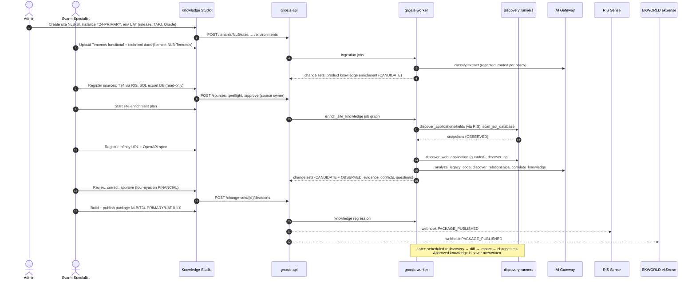

# 10 — Workflows and Worked Examples

> NLB examples are **illustrative**. Object names (`T24EXP`, `EXP_*`, routine names), the release and the export structure are placeholders chosen to show the mechanics. Real names come from discovery in Phase 1. T24 behaviour marked [VERIFY-T24] must be confirmed against the installed release's documentation.

## 1. End-to-end knowledge acquisition (§17 scenario)



Step-to-mechanism table:

| §17 step | Mechanism | Output state |
|---|---|---|
| 1 Create bank/site, register product/release/env | Topology API, `environment.release_id` | Site profile |
| 2 Upload Temenos docs | Ingestion pipeline (doc 06) | `source_artifact`, chunks |
| 3 Build/enrich Temenos knowledge | Extraction → consolidation → change set (PRODUCT scope, release-ranged) | CANDIDATE → reviewed |
| 4 Connect T24/jBASE or SQL source | `source_system` + preflight + approval | Approved source |
| 5 Discovery retrieves metadata | `discover_applications`, `discover_fields`, `scan_sql_database`, `discover_schema` | OBSERVED |
| 6 Supply URLs/API specs | `source_system(kind=WEB_APP/API)` | Approved sources |
| 7 Discover UI/API | `discover_web_application`, `discover_api` | OBSERVED structure, CANDIDATE semantics |
| 8 Correlate | `discover_relationships`, `analyze_legacy_code`, `correlate_knowledge` | CANDIDATE links with evidence |
| 9 Candidate site knowledge | Change sets grouped by concept, conflicts, open questions | UNDER_REVIEW |
| 10 Review & correct | Studio review, edits as new versions | VERIFIED / PROVISIONAL / REJECTED |
| 11 Available to RIS/EKWORLD | Package publication + webhooks | Published package version |
| 12 Rediscovery | Scheduled scan → snapshot diff → shadow re-interpretation → change sets | Approved knowledge untouched until new approval |

## 2. New-bank onboarding plan (`enrich_site_knowledge` job graph)

```yaml
plan: site-baseline
environment: NLB/T24-PRIMARY/UAT
steps:
  - id: apps      skill: discover_applications
  - id: fields    skill: discover_fields            needs: [apps]
  - id: sqlscan   skill: scan_sql_database          source: nlb-t24exp-uat
  - id: schema    skill: discover_schema            needs: [sqlscan]
  - id: xml       skill: analyze_xml_json_schema    needs: [schema]   when: "schema.has_xml_or_json_columns"
  - id: lineage   skill: discover_relationships     needs: [fields, schema, xml]
                  channels: [declared, product_docs, app_refs, approved_mappings, code]
  - id: code      skill: analyze_legacy_code        needs: [fields]    for_each: artifacts(type=JBC_SOURCE, env)
  - id: rules     skill: extract_business_rules     needs: [code]
  - id: web       skill: discover_web_application   source: nlb-infinity-uat   optional: true
  - id: api       skill: discover_api               source: nlb-transact-api-spec optional: true
  - id: corr      skill: correlate_knowledge        needs: [lineage, rules, web, api]
                  focus: consumer_demand            # concepts requested by RIS/EKWORLD first
  - id: conflicts skill: detect_knowledge_conflicts needs: [corr]
on_step_failure: checkpoint_and_continue_independent
```

## 3. NLB examples (RIS field definitions + exported T24 data)

### 3.1 Site profile

```json
{"tenant":"NLB","site":"NLB-SI","instance":"T24-PRIMARY","environment":"UAT",
 "product":"TEMENOS_TRANSACT","release":"<Rxx – from RIS/NLB>","runtime":"TAFJ","db_platform":"ORACLE",
 "sources":[{"kind":"T24_RIS_METADATA","name":"RIS T24 metadata (UAT)"},
            {"kind":"SQL","name":"T24 export DB (UAT)","schemas":["T24EXP"],"data_class":"METADATA_ONLY"}]}
```

### 3.2 Discovery output (abridged)

From RIS (`discover_fields`):

| application | field | no | type | MV | local | → product link |
|---|---|---|---|---|---|---|
| EB.CONTRACT.BALANCES | TYPE.SYSDATE | n₁ | A | MV | no | `instance_of tt:field:EB.CONTRACT.BALANCES>TYPE.SYSDATE` (release-matched → VERIFIED) |
| EB.CONTRACT.BALANCES | OPEN.BALANCE | n₂ | AMT | MV (assoc. with TYPE.SYSDATE) | no | VERIFIED |
| AA.ARRANGEMENT | PRODUCT.LINE | n₃ | A | — | no | VERIFIED |
| ACCOUNT | LOCAL.REF › NLB.RISK.CLASS | 1/7 | A | — | **yes** | none (local) → `definition = NULL`, open question |

From export DB (`scan_sql_database` → `discover_schema`):

| table | column | type | notes |
|---|---|---|---|
| T24EXP.EXP_ECB | CONTRACT_ID | VARCHAR2(35) | no declared PK |
| T24EXP.EXP_ECB_BALANCE_TYPE | CONTRACT_ID, MV_SEQ, BALANCE_TYPE, BALANCE_DATE, OPEN_BALANCE, CREDIT_MVMT, DEBIT_MVMT | … | one row per MV position (exploded export) |
| T24EXP.EXP_AA_ARRANGEMENT | ARRANGEMENT_ID, PRODUCT_LINE, ARR_STATUS, CURRENCY | … | — |
| T24EXP.EXP_ACCOUNT | ACCOUNT_ID, …, LOCAL_REF_XML | XMLTYPE | local refs exported as XML → `analyze_xml_json_schema` |

### 3.3 Export lineage proposals

`discover_relationships` produces:

| From → To | Channel | Basis | Status |
|---|---|---|---|
| `EXP_ECB_BALANCE_TYPE.OPEN_BALANCE` `exported_as` ← `EB.CONTRACT.BALANCES>OPEN.BALANCE` | RIS export mapping config [ASSUMPTION: RIS knows its export lineage] | SOURCE_METADATA | VERIFIED |
| `EXP_ECB_BALANCE_TYPE.BALANCE_TYPE` + `.BALANCE_DATE` ← `TYPE.SYSDATE` (export splits the composite type-date value) | Approved RIS mapping example | SPECIALIST_APPROVED | VERIFIED |
| `EXP_ECB.CONTRACT_ID` `joins_to` `EXP_AA_ARRANGEMENT.ARRANGEMENT_ID` | Product docs (ECB keyed by contract/arrangement id) + profiling (99.98 % inclusion) | DOCUMENTATION + DATA_PROFILED | CANDIDATE → reviewer |
| `EXP_ACCOUNT.LOCAL_REF_XML:/LOCAL.REF/c7` → `ACCOUNT>LOCAL.REF›NLB.RISK.CLASS` | Record-format decoder + local field position from RIS | SOURCE_METADATA | VERIFIED (structure). Meaning still open |

### 3.4 Legacy JBC → concept (RIS Sense use case)

1. RIS Sense uploads the legacy routine `NLB.LOAN.EXTRACT` that produced a regulatory loan file.
2. `analyze_legacy_code` yields an IR (doc 03 §6.1). The derivation `OUT.PRINCIPAL` sums ECB balance lines whose type matches `*ACCOUNT`.
3. The LLM interpretation (CANDIDATE) says `OUT.PRINCIPAL` realises *Outstanding Principal (incl. due and overdue)*. The counter-evidence check raises: "wildcard may include non-principal balance types configured with ACCOUNT suffix" → **open question** to the Lending/AA specialist.
4. The specialist answers with a site rule: *at NLB, principal balance types are `CURACCOUNT`, `DUEACCOUNT`, and overdue-status variants `<STATUS>ACCOUNT` for statuses configured in the overdue product condition; exclude `…` (site-specific).* The rule is stored as `site:rule:nlb.principal_balance_types` (VERIFIED, HIGH, four-eyes). [VERIFY-T24 balance-type naming]
5. `mappings:suggest` for `CRR_LOANS.PRINCIPAL_OUTSTANDING` then produces the DSL mapping shown in doc 04 §5, referencing the site rule (not the wildcard). `validate_mapping` checks the MV explode, currency grouping and business-date filter. `generate_sql` emits Oracle SQL:

```sql
SELECT a.ARRANGEMENT_ID,
       a.CURRENCY,
       SUM(b.OPEN_BALANCE + b.CREDIT_MVMT + b.DEBIT_MVMT) AS PRINCIPAL_OUTSTANDING
FROM   T24EXP.EXP_AA_ARRANGEMENT a
JOIN   T24EXP.EXP_ECB_BALANCE_TYPE b ON b.CONTRACT_ID = a.ARRANGEMENT_ID
WHERE  a.PRODUCT_LINE = 'LENDING'
  AND  a.ARR_STATUS IN ('CURRENT','EXPIRED')
  AND  b.BALANCE_TYPE IN (SELECT BALANCE_TYPE FROM RIS_CFG.SITE_RULE_VALUES
                          WHERE RULE_KEY = 'nlb.principal_balance_types')   -- materialised from site rule
  AND  b.BALANCE_DATE <= :business_date
GROUP  BY a.ARRANGEMENT_ID, a.CURRENCY
```

6. The reconciliation requirement is generated from the GL concept link: the sum of `PRINCIPAL_OUTSTANDING` per currency and category must reconcile to the GL lending asset lines for the same business date (tolerance 0). The recon query is proposed against the GL export, again as CANDIDATE.
7. The specialist approves. RIS Sense registers a `consumer_artifact` (with dependencies on the site rule, the two columns and the join) and submits to RIS Core.

## 4. EKWORLD examples using the same intelligence

### 4.1 UI discovery enrichment

EKWORLD discovers the Infinity/Transact screen "Loan Repayment" (fields: *Arrangement*, *Amount*, *Value Date*, *Settlement Account*; action *Submit*, **not executed**). GnosisLync:
- links *Arrangement* → `concept:lending.arrangement` (CANDIDATE, label + observed XHR to `…/arrangements/{id}`, CODE_OBSERVED-grade binding),
- links *Amount* → `concept:payments.repayment_amount`,
- returns rules anchored to this screen via `POST /v1/rules:search`:
  - `rule:lending.repayment_allocation_order` (generic): due amounts are settled by property in configured order (e.g. penalty, interest, principal). VERIFIED generic, with the site realisation `site:rule:nlb.repayment_order` VERIFIED.
  - `rule:lending.value_date_not_future` (validation, product default, site-overridable).

### 4.2 Test scenario generation

```gherkin
@rule:site:rule:nlb.repayment_order @concept:lending.outstanding_principal @category:boundary @generated
Feature: Partial repayment allocation for consumer loans (NLB UAT)

  Scenario: Partial repayment smaller than due interest leaves principal unchanged
    Given a synthetic consumer loan arrangement with
      | due_interest | due_principal | current_principal |
      | 120.00       | 500.00        | 9500.00           |
    When a repayment of 100.00 is applied with value date equal to the business date
    Then due interest must be 20.00
    And due principal must be 500.00
    And outstanding principal must be 10000.00
```

`expected values` are computed by the **pack reference implementation** of the VERIFIED allocation rule, not by the LLM. The LLM drafts scenario structure and wording only. Data requirements are emitted for EKWORLD's synthetic data provisioning.

### 4.3 Upgrade impact (EKWORLD)

When UAT moves to a new release, `compare_schema_versions` (RIS field snapshots R-old vs R-new) plus product-pack release notes knowledge show a changed validation on *Value Date*. Impact analysis flags EKWORLD tests tagged `@rule:rule:lending.value_date_not_future`. EKWORLD re-runs them, and failures are reviewed against the new verified rule.

## 5. One concept shared by RIS and EKWORLD

| Aspect | RIS Sense | EKWORLD ekSense |
|---|---|---|
| Concept | `concept:lending.outstanding_principal` | same entity |
| Site realisation | ECB balance lines + `site:rule:nlb.principal_balance_types` | same |
| Use | Report column mapping + SQL + reconciliation | Expected results after repayment, disbursement, overdue transitions |
| Evidence shown | Practice note, code facts, export lineage | Same evidence, UI/API bindings |
| Dependency registration | `consumer_artifact(RIS, rptdef:CRR_LOANS#PRINCIPAL_OUTSTANDING)` | `consumer_artifact(EKWORLD, tc:LN-REG-0042)` |
| On rule change | Mapping → `NEEDS_REVIEW` | Expected results regenerated and re-reviewed |

The knowledge is built once, reviewed once and versioned once, then consumed twice. Consumers never copy it. They pin a package version.

## 6. Continuous maintenance triggers

| Trigger | Detection | Action |
|---|---|---|
| Release upgrade | Admin records the new environment release, or RIS metadata reports a version change | New environment row. Full rediscovery. Release-range filter changes the applicable product knowledge. Diff vs previous env baseline |
| Field metadata change | Scheduled `discover_fields` (daily/weekly) + snapshot diff | Change set. Impact analysis |
| Custom routine modified | Code repo webhook or periodic hash check | Re-analyse → IR diff → FINANCIAL if derivations changed |
| New interface / export schema | `scan_sql_database` diff (new objects) | Candidates + lineage proposals |
| Documentation updated | Upload with `supersedes` | Re-extraction in shadow. Evidence of old version marked superseded. Change set |
| Approved mapping corrected | RIS correction event → `POST /v1/contributions` or change set | New version. Dependents flagged |

In every case, approved knowledge stays served until a reviewed replacement is published.
